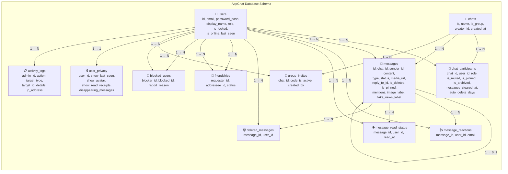

# AppChat — Cơ sở dữ liệu

Cơ sở dữ liệu AppChat sử dụng MySQL với engine `InnoDB`, bảng mã `utf8mb4_unicode_ci`. Toàn bộ tương tác phía backend thông qua SQLAlchemy Async với driver `aiomysql`. Mỗi bảng có cột `created_at` mặc định `CURRENT_TIMESTAMP` ở phía database. Các cột `updated_at` ngoài default còn có `ON UPDATE` tự động cập nhật khi bản ghi thay đổi. Một số cột và bảng được bổ sung sau bằng migration idempotent (chạy lại không lỗi nếu đã tồn tại), giúp giữ lịch sử schema rõ ràng trong code.

---

## Các thực thể trong cơ sở dữ liệu

### 1. Thực thể Users — Tài khoản người dùng

Bảng `users` là thực thể trung tâm của toàn hệ thống, lưu mọi tài khoản đăng nhập. Mỗi bản ghi đại diện cho một người dùng với thông tin xác thực, hồ sơ công khai, và trạng thái hiện diện. Cột `role` phân chia quyền hạn thành hai cấp: `user` cho người dùng thường và `admin` cho quản trị viên. Trạng thái `is_locked` cho phép quản trị viên khóa tài khoản mà không xóa dữ liệu, phù hợp khi phát hiện hành vi vi phạm. Trạng thái `is_online` và `last_seen` phản ánh mức độ hiện diện của người dùng trong thời gian thực, phục vụ tính năng "đang nhập" và "hoạt động gần đây" trên giao diện.

### 2. Thực thể Chats — Cuộc trò chuyện

Bảng `chats` đại diện cho mỗi cuộc trò chuyện, có thể là giữa hai người hoặc một nhóm nhiều người. Cột `is_group` phân biệt hai loại: `FALSE` nghĩa là chat một đối một (không có tên nhóm, tên hiển thị trên giao diện là tên của người kia), `TRUE` nghĩa là nhóm chat (có tên và ảnh nhóm riêng, `creator_id` ghi lại ai đã tạo nhóm). Bảng `chats` chỉ lưu thông tin cấp cuộc trò chuyện, không lưu tin nhắn. Việc lưu tin nhắn thuộc về bảng `messages`.

### 3. Thực thể ChatParticipants — Thành viên cuộc trò chuyện

Đây là bảng liên kết nhiều-nhiều giữa `users` và `chats`, mỗi bản ghi thể hiện một người tham gia một cuộc trò chuyện cụ thể. Bảng này còn chứa cài đặt cá nhân của từng thành viên trong cuộc trò chuyện đó: có thể tắt thông báo (`is_muted`), ghim cuộc trò chuyện lên đầu danh sách (`is_pinned`), lưu trữ để ẩn khỏi danh sách chính (`is_archived`), hoặc ẩn hoàn toàn (`is_hidden`). Cột `role` trong bảng này quyết định người đó có quyền admin nhóm hay không (thêm thành viên, đổi tên, tạo link mời). Cột `messages_cleared_at` ghi lại thời điểm người đó xóa lịch sử, kết hợp `auto_delete_days` để hỗ trợ tin nhắn tự hủy theo thời gian quy định.

### 4. Thực thể Messages — Tin nhắn

Bảng `messages` lưu mọi tin nhắn trong hệ thống, hỗ trợ nhiều loại nội dung: văn bản thuần (`text`), ảnh, video, file đính kèm, ghi âm, vị trí, và tin nhắn hệ thống (`system` dùng cho thông báo nhóm). Mỗi tin nhắn gắn với một cuộc trò chuyện qua `chat_id` và một người gửi qua `sender_id`. Tin nhắn có thể reply một tin nhắn khác qua `reply_to_id`, tạo thành chuỗi thảo luận. Cột `is_deleted` đánh dấu tin nhắn đã bị thu hồi, khi đó nội dung gốc được ẩn và hiển thị nhãn "Tin nhắn đã thu hồi". Cột `is_pinned` cho phép ghim tối đa ba tin nhắn quan trọng trong mỗi cuộc trò chuyện. Cột `image_label` và `fake_news_label` lưu kết quả phân loại từ mô hình ML. Cột `expires_at` hỗ trợ tính năng tin nhắn tự hủy khi đến thời điểm quy định. Cột `mentions` dạng JSON lưu danh sách user được nhắc tên (`@user`), giúp server gửi thông báo riêng tới từng người được nhắc.

### 5. Thực thể MessageReactions — Biểu cảm

Bảng `message_reactions` cho phép nhiều người dùng thả nhiều loại biểu cảm (emoji) lên cùng một tin nhắn. Mỗi bản ghi gồm tin nhắn được react, người react, và emoji cụ thể. Nếu cùng một người react cùng một emoji hai lần, SQL constraint (unique message_id + user_id + emoji) sẽ ngăn chặn bản ghi trùng lặp.

### 6. Thực thể MessageReadStatus — Trạng thái đã đọc

Bảng `message_read_status` theo dõi chính xác từng người đã đọc từng tin nhắn nào và vào lúc nào. Dựa vào bảng này, ứng dụng tính được số tin nhắn chưa đọc của mỗi cuộc trò chuyện và hiển thị dấu "đã xem" dưới tin nhắn.

### 7. Thực thể DeletedMessages — Tin nhắn đã xóa riêng

Bảng `deleted_messages` phục vụ tính năng "xóa phía mình" (delete for me). Khi một người xóa một tin nhắn chỉ ảnh hưởng bản thân, hệ thống không xóa bản ghi `messages` mà tạo một bản ghi trong `deleted_messages` để đánh dấu tin nhắn đó bị ẩn với người đó. Người khác vẫn thấy bình thường.

### 8. Thực thể Friendships — Quan hệ bạn bè

Bảng `friendships` lưu quan hệ kết bạn giữa hai người dùng. Mỗi lời mời kết bạn tạo một bản ghi với trạng thái `pending`, khi được chấp nhận thì chuyển thành `accepted`. Bảng này lưu theo chiều: `requester_id` gửi lời mời tới `addressee_id`. Nếu A kết bạn B thì tồn tại bản ghi A→B; chiều B→A không cần vì quan hệ là đối xứng, kiểm tra `are_friends` sẽ xác nhận cả hai chiều.

### 9. Thực thể BlockedUsers — Người dùng bị chặn

Bảng `blocked_users` cho phép người dùng chặn nhau. Khi A chặn B, A không thấy B trong kết quả tìm kiếm, và B không thể gửi tin nhắn tới A. Quan hệ này không đối xứng: A chặn B không có nghĩa B chặn A. Cột `report_reason` lưu lý do báo cáo kèm theo khi chặn, phục vụ quản trị viên xem xét nếu cần.

### 10. Thực thể GroupInvites — Liên kết mời nhóm

Bảng `group_invites` lưu liên kết mời tham gia nhóm. Mỗi nhóm có thể có nhiều link nhưng chỉ một link còn `is_active`. Mã `code` được tạo bằng `secrets.token_urlsafe(16)` cho độ dài và tính ngẫu nhiên cao, khó đoán. Khi tạo link mới, link cũ tự động bị vô hiệu hóa. Cột `expires_at` dự phòng cho tương lai mở rộng thêm giới hạn thời gian link.

### 11. Thực thể UserPrivacy — Cài đặt quyền riêng tư

Bảng `user_privacy` lưu cài đặt quyền riêng tư theo từng người dùng, quan hệ một-một với bảng `users`. Mỗi người có bốn cài đặt chính: ai được xem lần cuối truy cập (`show_last_seen`), ai được xem ảnh đại diện (`show_avatar`), có hiển thị đã xem hay không (`show_read_receipts`), và thời gian tin nhắn tự biến mất (`disappearing_messages`). Các trường `show_last_seen` và `show_avatar` có ba giá trị: `everyone` (mọi người), `friends` (chỉ bạn bè), `nobody` (không ai). Cài đặt `disappearing_messages` lưu số giây: `0` là tắt, `86400` là 24 giờ, `604800` là 7 ngày, `7776000` là 90 ngày.

### 12. Thực thể ActivityLogs — Nhật ký hành động quản trị

Bảng `activity_logs` ghi lại mọi hành động nhạy cảm của quản trị viên: khóa tài khoản, xóa người dùng, giải tán nhóm, đặt lại mật khẩu. Mỗi bản ghi gồm ai thực hiện (`admin_id`), hành động cụ thể (`action`), loại và mã đối tượng bị tác động, mô tả chi tiết, địa chỉ IP để truy vết nguồn gốc, và thời điểm. Cơ chế này vừa phục vụ kiểm toán, vừa có tác dụng răn đe hành động lạm quyền.

---

## Chi tiết các bảng

### Bảng 1 — users

| Cột | Kiểu | Nullable | Mặc định | Ràng buộc | Mô tả |
|------|------|----------|-----------|-----------|-------|
| `id` | INT | NO | Tự tăng | PK | Mã định danh người dùng |
| `email` | VARCHAR(255) | NO | — | UNIQUE, INDEX | Email dùng để đăng nhập, duy nhất trong hệ thống |
| `password_hash` | VARCHAR(255) | NO | — | — | Mật khẩu đã băm bằng bcrypt, không bao giờ lưu dạng gốc |
| `display_name` | VARCHAR(100) | NO | — | — | Tên hiển thị trên giao diện và trong danh sách |
| `avatar_url` | LONGTEXT | YES | NULL | — | Ảnh đại diện dạng base64 hoặc URL, có thể chưa đặt |
| `role` | VARCHAR(20) | NO | `"user"` | — | Phân quyền: `user` (thường) hoặc `admin` (quản trị) |
| `is_locked` | BOOLEAN | NO | FALSE | — | TRUE khi tài khoản bị quản trị viên khóa, ngăn đăng nhập |
| `is_online` | BOOLEAN | NO | FALSE | — | TRUE khi đang kết nối Socket.IO, cập nhật realtime |
| `last_seen` | DATETIME | YES | NULL | — | Thời điểm cuối cùng hoạt động, có thể bị ẩn theo quyền riêng tư |
| `created_at` | DATETIME | NO | CURRENT_TIMESTAMP | — | Ngày tạo tài khoản |
| `updated_at` | DATETIME | NO | CURRENT_TIMESTAMP + ON UPDATE | — | Ngày cập nhật gần nhất |

---

### Bảng 2 — chats

| Cột | Kiểu | Nullable | Mặc định | Ràng buộc | Mô tả |
|------|------|----------|-----------|-----------|-------|
| `id` | INT | NO | Tự tăng | PK | Mã định danh cuộc trò chuyện |
| `name` | VARCHAR(100) | YES | NULL | — | Tên nhóm, NULL khi là chat 1-1 |
| `avatar_url` | LONGTEXT | YES | NULL | — | Ảnh đại diện nhóm, NULL khi là chat 1-1 |
| `is_group` | BOOLEAN | NO | FALSE | — | TRUE = nhóm chat, FALSE = chat giữa hai người |
| `creator_id` | INT | YES | NULL | FK → `users.id` | Người tạo nhóm, NULL khi là chat 1-1 |
| `created_at` | DATETIME | NO | CURRENT_TIMESTAMP | — | Ngày tạo cuộc trò chuyện |
| `updated_at` | DATETIME | NO | CURRENT_TIMESTAMP + ON UPDATE | — | Ngày cập nhật gần nhất (thường là tin nhắn mới nhất) |

---

### Bảng 3 — chat_participants

| Cột | Kiểu | Nullable | Mặc định | Ràng buộc | Mô tả |
|------|------|----------|-----------|-----------|-------|
| `id` | INT | NO | Tự tăng | PK | Mã bản ghi tham gia |
| `chat_id` | INT | NO | — | FK → `chats.id` ON DELETE CASCADE | Cuộc trò chuyện tham gia |
| `user_id` | INT | NO | — | FK → `users.id` ON DELETE CASCADE | Người tham gia |
| `role` | VARCHAR(20) | NO | `"member"` | — | `admin` (quản lý nhóm) hoặc `member` |
| `is_muted` | BOOLEAN | NO | FALSE | — | TRUE khi tắt thông báo cuộc trò chuyện này |
| `is_pinned` | BOOLEAN | NO | FALSE | — | TRUE khi ghim cuộc trò chuyện lên đầu danh sách |
| `is_archived` | BOOLEAN | NO | FALSE | — | TRUE khi lưu trữ (ẩn khỏi danh sách chính) |
| `is_hidden` | BOOLEAN | NO | FALSE | — | TRUE khi ẩn hoàn toàn cuộc trò chuyện |
| `messages_cleared_at` | DATETIME | YES | NULL | — | Thời điểm người này xóa lịch sử, dùng để ẩn tin cũ |
| `auto_delete_days` | INT | YES | NULL | — | Số ngày tự xóa tin nhắn: 1, 7, 14 hoặc NULL (tắt) |
| `joined_at` | DATETIME | NO | CURRENT_TIMESTAMP | — | Ngày tham gia cuộc trò chuyện |

---

### Bảng 4 — messages

| Cột | Kiểu | Nullable | Mặc định | Ràng buộc | Mô tả |
|------|------|----------|-----------|-----------|-------|
| `id` | INT | NO | Tự tăng | PK | Mã định danh tin nhắn |
| `chat_id` | INT | NO | — | FK → `chats.id` ON DELETE CASCADE | Cuộc trò chuyện chứa tin nhắn |
| `sender_id` | INT | YES | NULL | FK → `users.id` ON DELETE SET NULL | Người gửi, SET NULL khi tài khoản bị xóa |
| `content` | TEXT | NO | — | — | Nội dung tin nhắn (văn bản, mô tả file, tọa độ...) |
| `type` | VARCHAR(20) | NO | `"text"` | — | Loại: `text`, `image`, `video`, `file`, `audio`, `location`, `system` |
| `status` | VARCHAR(20) | NO | `"sent"` | — | Trạng thái: `sending`, `sent`, `delivered`, `read`, `failed` |
| `media_url` | LONGTEXT | YES | NULL | — | URL file đính kèm (ảnh, video, file, audio) |
| `thumbnail_url` | LONGTEXT | YES | NULL | — | URL ảnh thu nhỏ của video hoặc file |
| `reply_to_id` | INT | YES | NULL | FK → `messages.id` ON DELETE SET NULL | Mã tin nhắn được reply, tạo chuỗi thảo luận |
| `is_deleted` | BOOLEAN | NO | FALSE | — | TRUE khi tin nhắn đã bị thu hồi cho mọi người |
| `is_pinned` | BOOLEAN | NO | FALSE | — | TRUE khi được ghim trong cuộc trò chuyện (tối đa 3) |
| `forwarded` | BOOLEAN | NO | FALSE | — | TRUE khi là tin nhắn chuyển tiếp từ cuộc trò chuyện khác |
| `image_label` | VARCHAR(50) | YES | NULL | — | Nhãn phân loại ảnh từ mô hình ML (ví dụ: tabby_cat, dog) |
| `expires_at` | DATETIME | YES | NULL | — | Thời điểm tin nhắn tự hủy (tính năng tin nhắn tự biến mất) |
| `voice_duration` | INT | YES | NULL | — | Thời lượng ghi âm tính bằng mili giây |
| `fake_news_label` | VARCHAR(50) | YES | NULL | — | Nhãn tin giả 6 lớp từ bộ phân loại ML |
| `mentions` | JSON | YES | NULL | — | Mảng ID người được nhắc tên, hoặc `["all"]` để nhắc cả nhóm |
| `created_at` | DATETIME | NO | CURRENT_TIMESTAMP | — | Thời điểm gửi tin nhắn |
| `edited_at` | DATETIME | YES | NULL | — | Thời điểm chỉnh sửa cuối cùng, NULL nếu chưa sửa |

---

### Bảng 5 — message_reactions

| Cột | Kiểu | Nullable | Mặc định | Ràng buộc | Mô tả |
|------|------|----------|-----------|-----------|-------|
| `id` | INT | NO | Tự tăng | PK | Mã bản ghi reaction |
| `message_id` | INT | NO | — | FK → `messages.id` ON DELETE CASCADE | Tin nhắn được react |
| `user_id` | INT | NO | — | FK → `users.id` ON DELETE CASCADE | Người thả reaction |
| `emoji` | VARCHAR(50) | NO | — | — | Emoji reaction (ví dụ: `👍`, `❤️`, `😂`) |
| `created_at` | DATETIME | NO | CURRENT_TIMESTAMP | — | Thời điểm thả reaction |

---

### Bảng 6 — message_read_status

| Cột | Kiểu | Nullable | Mặc định | Ràng buộc | Mô tả |
|------|------|----------|-----------|-----------|-------|
| `id` | INT | NO | Tự tăng | PK | Mã bản ghi trạng thái đọc |
| `message_id` | INT | NO | — | FK → `messages.id` ON DELETE CASCADE | Tin nhắn đã đọc |
| `user_id` | INT | NO | — | FK → `users.id` ON DELETE CASCADE | Người đọc tin nhắn |
| `read_at` | DATETIME | NO | CURRENT_TIMESTAMP | — | Thời điểm đọc |

---

### Bảng 7 — deleted_messages

| Cột | Kiểu | Nullable | Mặc định | Ràng buộc | Mô tả |
|------|------|----------|-----------|-----------|-------|
| `id` | INT | NO | Tự tăng | PK | Mã bản ghi xóa |
| `message_id` | INT | NO | — | FK → `messages.id` ON DELETE CASCADE | Tin nhắn bị xóa phía người này |
| `user_id` | INT | NO | — | FK → `users.id` ON DELETE CASCADE | Người thực hiện xóa |
| `deleted_at` | DATETIME | NO | CURRENT_TIMESTAMP | — | Thời điểm xóa |

---

### Bảng 8 — friendships

| Cột | Kiểu | Nullable | Mặc định | Ràng buộc | Mô tả |
|------|------|----------|-----------|-----------|-------|
| `id` | INT | NO | Tự tăng | PK | Mã bản ghi kết bạn |
| `requester_id` | INT | NO | — | FK → `users.id` ON DELETE CASCADE | Người gửi lời mời kết bạn |
| `addressee_id` | INT | NO | — | FK → `users.id` ON DELETE CASCADE | Người nhận lời mời |
| `status` | VARCHAR(20) | NO | `"pending"` | — | `pending` (đang chờ) hoặc `accepted` (đã chấp nhận) |
| `created_at` | DATETIME | NO | CURRENT_TIMESTAMP | — | Ngày gửi lời mời |
| `updated_at` | DATETIME | NO | CURRENT_TIMESTAMP + ON UPDATE | — | Ngày chấp nhận hoặc từ chối |

---

### Bảng 9 — blocked_users

| Cột | Kiểu | Nullable | Mặc định | Ràng buộc | Mô tả |
|------|------|----------|-----------|-----------|-------|
| `id` | INT | NO | Tự tăng | PK | Mã bản ghi chặn |
| `blocker_id` | INT | NO | — | FK → `users.id` ON DELETE CASCADE | Người thực hiện chặn |
| `blocked_id` | INT | NO | — | FK → `users.id` ON DELETE CASCADE | Người bị chặn |
| `report_reason` | TEXT | YES | NULL | — | Lý do báo cáo khi chặn, phục vụ quản trị xem xét |
| `created_at` | DATETIME | NO | CURRENT_TIMESTAMP | — | Ngày chặn |

---

### Bảng 10 — group_invites

| Cột | Kiểu | Nullable | Mặc định | Ràng buộc | Mô tả |
|------|------|----------|-----------|-----------|-------|
| `id` | INT | NO | Tự tăng | PK | Mã bản ghi link mời |
| `chat_id` | INT | NO | — | FK → `chats.id` ON DELETE CASCADE | Nhóm được mời tham gia |
| `code` | VARCHAR(32) | NO | — | UNIQUE | Mã mời ngẫu nhiên 16 byte từ `secrets.token_urlsafe` |
| `created_by` | INT | YES | NULL | FK → `users.id` ON DELETE SET NULL | Người tạo link mời |
| `is_active` | BOOLEAN | NO | TRUE | — | FALSE khi link bị thu hồi hoặc thay thế bằng link mới |
| `created_at` | DATETIME | NO | CURRENT_TIMESTAMP | — | Ngày tạo link |
| `expires_at` | DATETIME | YES | NULL | — | Ngày hết hạn link, NULL nghĩa là không hết hạn |

---

### Bảng 11 — user_privacy

| Cột | Kiểu | Nullable | Mặc định | Ràng buộc | Mô tả |
|------|------|----------|-----------|-----------|-------|
| `id` | INT | NO | Tự tăng | PK | Mã bản ghi quyền riêng tư |
| `user_id` | INT | NO | — | FK → `users.id` ON DELETE CASCADE, UNIQUE | Người dùng sở hữu cài đặt, mỗi người có đúng một bản ghi |
| `show_last_seen` | VARCHAR(20) | NO | `"everyone"` | — | Ai được xem lần cuối: `everyone`, `friends`, `nobody` |
| `show_avatar` | VARCHAR(20) | NO | `"everyone"` | — | Ai được xem avatar: `everyone`, `friends`, `nobody` |
| `show_read_receipts` | BOOLEAN | NO | TRUE | — | TRUE cho phép người khác thấy mình đã đọc tin |
| `disappearing_messages` | INT | NO | 0 | — | Thời gian tin nhắn tự xóa (giây): 0 (tắt), 86400 (24h), 604800 (7d), 7776000 (90d) |
| `updated_at` | DATETIME | NO | CURRENT_TIMESTAMP + ON UPDATE | — | Ngày cập nhật cài đặt gần nhất |

---

### Bảng 12 — activity_logs

| Cột | Kiểu | Nullable | Mặc định | Ràng buộc | Mô tả |
|------|------|----------|-----------|-----------|-------|
| `id` | INT | NO | Tự tăng | PK | Mã bản ghi nhật ký |
| `admin_id` | INT | YES | NULL | FK → `users.id` ON DELETE SET NULL | Quản trị viên thực hiện hành động |
| `action` | VARCHAR(100) | NO | — | — | Hành động cụ thể: `lock_user`, `delete_user`, `delete_group`, `reset_password`... |
| `target_type` | VARCHAR(50) | YES | NULL | — | Loại đối tượng bị tác động: `user`, `group`, `message` |
| `target_id` | INT | YES | NULL | — | Mã đối tượng bị tác động |
| `details` | TEXT | YES | NULL | — | Mô tả chi tiết hành động bằng tiếng Việt |
| `ip_address` | VARCHAR(45) | YES | NULL | — | Địa chỉ IP của quản trị viên khi thực hiện (đủ cho IPv6) |
| `created_at` | DATETIME | NO | CURRENT_TIMESTAMP | — | Thời điểm thực hiện hành động |

---

## Sơ đồ quan hệ

