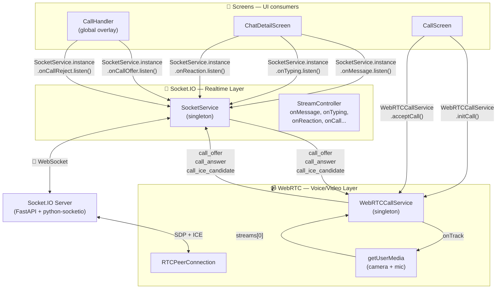
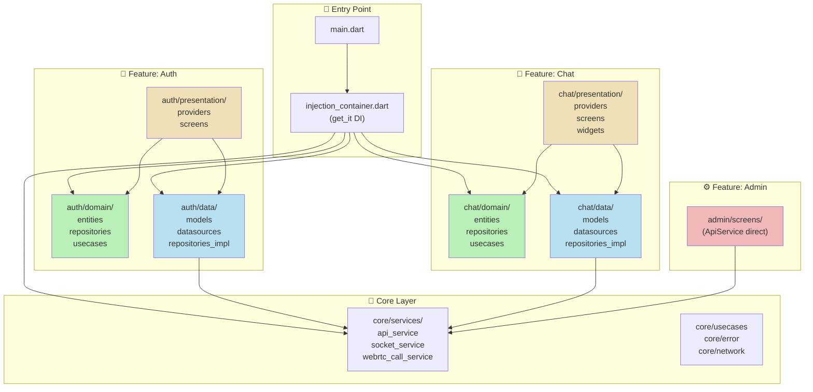

# AppChat — Kiến trúc Clean Architecture

Tài liệu này phân tích và chứng minh dự án AppChat triển khai theo kiến trúc **Clean Architecture**. Phần 1 trình bày tổ chức thư mục và các lớp theo đúng nguyên lý Uncle Bob. Phần 2 minh họa luồng dữ liệu từ giao diện người dùng xuống tầng dữ liệu.

---

## 1. Cấu trúc thư mục

### 1.1. Tổng quan

Dự án tổ chức theo hai nhóm song song: **lớp `core/`** chứa các thành phần dùng chung toàn ứng dụng, **lớp `features/`** chứa các tính năng độc lập theo từng domain. Mỗi feature tuân theo cấu trúc ba lớp **Domain → Data → Presentation**.

```
lib/
├── main.dart                              # Điểm khởi đầu ứng dụng
├── injection_container.dart               # Service Locator (get_it) cho DI
├── widgets/
│   └── loading_overlay.dart               # Widget chia sẻ toàn app
├── core/                                  # Lớp chia sẻ, không phụ thuộc feature
│   ├── constants/
│   │   ├── app_config.dart                # URL backend, URL websocket
│   │   ├── app_colors.dart                # Bảng màu theme
│   │   └── app_routes.dart                # Định nghĩa route name
│   ├── error/
│   │   ├── exceptions.dart                # ServerException, CacheException
│   │   └── failures.dart                  # Failure cho Either<Failure, T>
│   ├── network/
│   │   └── network_info.dart              # Kiểm tra kết nối internet
│   ├── services/
│   │   ├── api_service.dart               # HTTP client — 50+ endpoint REST
│   │   ├── socket_service.dart            # Socket.IO realtime
│   │   └── webrtc_call_service.dart       # WebRTC peer connection
│   ├── themes/
│   │   ├── app_theme.dart                 # Định nghĩa light/dark theme
│   │   └── theme_provider.dart            # Quản lý theme + locale + font size
│   ├── usecases/
│   │   └── usecase.dart                   # Base class UseCase<T, Params>
│   └── utils/
│       ├── time_utils.dart
│       ├── account_manager.dart
│       └── app_localizations.dart         # i18n vi/en
└── features/                              # Mỗi feature = một domain nghiệp vụ
    ├── auth/
    │   ├── domain/                         # ★ Lớp Domain
    │   │   ├── entities/user_entity.dart
    │   │   ├── repositories/auth_repository.dart
    │   │   └── usecases/
    │   │       ├── login_usecase.dart
    │   │       ├── register_usecase.dart
    │   │       ├── logout_usecase.dart
    │   │       └── get_current_user_usecase.dart
    │   ├── data/                           # ★ Lớp Data
    │   │   ├── models/user_model.dart
    │   │   ├── datasources/
    │   │   │   ├── auth_remote_data_source.dart
    │   │   │   └── auth_local_data_source.dart
    │   │   └── repositories/auth_repository_impl.dart
    │   ├── presentation/                   # ★ Lớp Presentation
    │   │   ├── providers/
    │   │   │   └── auth_notifier.dart
    │   │   └── screens/
    │   │       ├── login_screen.dart
    │   │       ├── register_screen.dart
    │   │       └── forgot_password_screen.dart
    │   └── providers/
    │       └── auth_provider.dart          # Provider thực tế đang dùng
    ├── chat/
    │   ├── domain/
    │   │   ├── entities/
    │   │   │   ├── chat_entity.dart
    │   │   │   └── message_entity.dart
    │   │   ├── repositories/
    │   │   │   ├── chat_repository.dart
    │   │   │   └── message_repository.dart
    │   │   └── usecases/
    │   │       ├── get_chats_usecase.dart
    │   │       ├── get_messages_usecase.dart
    │   │       └── send_message_usecase.dart
    │   ├── data/
    │   │   ├── models/
    │   │   │   ├── chat_model.dart
    │   │   │   └── message_model.dart
    │   │   ├── datasources/
    │   │   │   └── chat_remote_data_source.dart
    │   │   └── repositories/
    │   │       ├── chat_repository_impl.dart
    │   │       └── message_repository_impl.dart
    │   ├── presentation/
    │   │   ├── providers/
    │   │   │   ├── chat_provider.dart     # ChatNotifier
    │   │   │   └── message_provider.dart  # MessageNotifier
    │   │   ├── screens/
    │   │   │   ├── chat_list_screen.dart
    │   │   │   ├── chat_detail_screen.dart
    │   │   │   ├── create_chat_screen.dart
    │   │   │   ├── group_settings_screen.dart
    │   │   │   └── join_group_screen.dart
    │   │   └── widgets/
    │   │       ├── message_bubble.dart
    │   │       └── link_preview.dart
    ├── admin/
    │   └── screens/
    │       ├── admin_dashboard_screen.dart
    │       ├── admin_users_tab.dart
    │       ├── admin_groups_tab.dart
    │       ├── admin_stats_tab.dart
    │       └── admin_activity_log_tab.dart
    ├── profile/
    │   └── screens/
    │       ├── profile_screen.dart
    │       ├── privacy_settings_screen.dart
    │       └── blocked_users_screen.dart
    └── friends/
        └── screens/
            └── friends_screen.dart
```

### 1.2. Nguyên tắc tổ chức

| Thư mục | Nguyên tắc | Ví dụ file |
|---------|-----------|-----------|
| `domain/entities/` | Plain Dart object, `Equatable`, không phụ thuộc framework | `user_entity.dart`, `message_entity.dart` |
| `domain/repositories/` | Interface trừu tượng, không có implementation | `auth_repository.dart` |
| `domain/usecases/` | Một class cho một hành động nghiệp vụ | `login_usecase.dart`, `get_chats_usecase.dart` |
| `data/models/` | Mở rộng entity, thêm `fromJson`/`toJson` | `user_model.dart extends UserEntity` |
| `data/datasources/` | Giao tiếp HTTP hoặc local storage | `auth_remote_data_source.dart`, `auth_local_data_source.dart` |
| `data/repositories/` | Implement interface domain, map Exception → Failure | `auth_repository_impl.dart` |
| `presentation/providers/` | `ChangeNotifier`, gọi UseCase, `notifyListeners()` | `auth_notifier.dart`, `chat_provider.dart` |
| `presentation/screens/` | Widget, gọi Provider, nhận state | `login_screen.dart`, `chat_detail_screen.dart` |
| `core/services/` | Singleton/shared service, không thuộc feature nào | `api_service.dart`, `socket_service.dart` |

---

## 2. Ba lớp Clean Architecture

### 2.1. Lớp Domain — Quy tắc nghiệp vụ thuần túy

Domain là lớp **không phụ thuộc** vào Flutter SDK, HTTP client, hay bất kỳ framework nào. Nó chỉ chứa các đối tượng mô hình và interface.

**Entity** — đối tượng nghiệp vụ cơ bản, mở rộng `Equatable` để so sánh bằng giá trị:

```dart
// lib/features/auth/domain/entities/user_entity.dart
import 'package:equatable/equatable.dart';

/// Entity đại diện cho User trong domain layer
/// Không phụ thuộc vào framework hay data source
class UserEntity extends Equatable {
  final String id;
  final String email;
  final String displayName;
  final String? avatarUrl;
  final String role;
  final bool isLocked;
  final bool isOnline;
  final DateTime? lastSeen;
  final DateTime createdAt;

  const UserEntity({
    required this.id,
    required this.email,
    required this.displayName,
    this.avatarUrl,
    required this.role,
    required this.isLocked,
    required this.isOnline,
    this.lastSeen,
    required this.createdAt,
  });

  // Các getter tiện ích
  bool get isAdmin => role == 'admin';
  bool get isActive => !isLocked;

  @override
  List<Object?> get props => [id, email, displayName, role, isLocked, isOnline];
}
```

```dart
// lib/features/chat/domain/entities/message_entity.dart
import 'package:equatable/equatable.dart';

/// Entity đại diện cho tin nhắn
class MessageEntity extends Equatable {
  final String id;
  final String chatId;
  final String senderId;
  final String? senderName;
  final String? content;
  final String type;       // text, image, video, file, call, system
  final String status;    // sending, sent, delivered, read
  final String? mediaUrl;
  final String? thumbnailUrl;
  final String? replyToId;
  final bool isDeleted;
  final bool isPinned;
  final DateTime createdAt;
  final DateTime? editedAt;

  const MessageEntity({
    required this.id,
    required this.chatId,
    required this.senderId,
    this.senderName,
    this.content,
    required this.type,
    required this.status,
    this.mediaUrl,
    this.thumbnailUrl,
    this.replyToId,
    this.isDeleted = false,
    this.isPinned = false,
    required this.createdAt,
    this.editedAt,
  });

  bool get isText => type == 'text';
  bool get isMedia => ['image', 'video', 'file'].contains(type);
  bool get isCall => type == 'call';
  bool get isSystem => type == 'system';

  @override
  List<Object?> get props => [id, chatId, senderId, content, type, status, isDeleted, isPinned];
}
```

**Repository interface** — khai báo abstract method, không implement:

```dart
// lib/features/auth/domain/repositories/auth_repository.dart
import 'package:dartz/dartz.dart';
import '../../../../core/error/failures.dart';
import '../entities/user_entity.dart';

/// Interface trừu tượng cho Auth
/// Data layer sẽ implement, domain layer chỉ phụ thuộc abstraction này
abstract class AuthRepository {
  /// Đăng nhập
  Future<Either<Failure, UserEntity>> login({
    required String email,
    required String password,
  });

  /// Đăng ký tài khoản mới
  Future<Either<Failure, UserEntity>> register({
    required String email,
    required String password,
    required String displayName,
  });

  /// Đăng xuất
  Future<Either<Failure, void>> logout();

  /// Lấy thông tin user hiện tại
  Future<Either<Failure, UserEntity>> getCurrentUser();

  /// Kiểm tra đã đăng nhập chưa
  Future<bool> isLoggedIn();

  /// Làm mới token
  Future<Either<Failure, void>> refreshToken();
}
```

**UseCase** — một class cho một hành động duy nhất, tuân theo `UseCase<T, Params>`:

```dart
// lib/core/usecases/usecase.dart
import 'package:dartz/dartz.dart';
import '../error/failures.dart';

/// Base class cho tất cả UseCase
/// T: kiểu trả về khi thành công
/// Params: tham số truyền vào
abstract class UseCase<T, Params> {
  Future<Either<Failure, T>> call(Params params);
}

/// Dùng khi UseCase không cần tham số
class NoParams {
  const NoParams();
}
```

```dart
// lib/features/auth/domain/usecases/login_usecase.dart
import 'package:dartz/dartz.dart';
import '../../../../core/error/failures.dart';
import '../../../../core/usecases/usecase.dart';
import '../entities/user_entity.dart';
import '../repositories/auth_repository.dart';

/// UseCase cho đăng nhập
/// Mỗi UseCase chỉ làm một việc duy nhất
class LoginUseCase implements UseCase<UserEntity, LoginParams> {
  final AuthRepository repository;

  LoginUseCase(this.repository);

  @override
  Future<Either<Failure, UserEntity>> call(LoginParams params) {
    return repository.login(
      email: params.email,
      password: params.password,
    );
  }
}

/// Params cho LoginUseCase
class LoginParams {
  final String email;
  final String password;

  const LoginParams({required this.email, required this.password});
}
```

```dart
// lib/features/chat/domain/usecases/get_chats_usecase.dart
import 'package:dartz/dartz.dart';
import '../../../../core/error/failures.dart';
import '../../../../core/usecases/usecase.dart';
import '../entities/chat_entity.dart';
import '../repositories/chat_repository.dart';

class GetChatsUseCase implements UseCase<List<ChatEntity>, NoParams> {
  final ChatRepository repository;

  GetChatsUseCase(this.repository);

  @override
  Future<Either<Failure, List<ChatEntity>>> call(NoParams params) {
    return repository.getChats();
  }
}
```

### 2.2. Lớp Data — Triển khai và ánh xạ

Data layer chịu trách nhiệm **ánh xạ** dữ liệu từ/đến backend, xử lý HTTP, cache local, và triển khai repository interface.

**Model** — mở rộng entity, thêm serialization:

```dart
// lib/features/auth/data/models/user_model.dart
import '../../domain/entities/user_entity.dart';

/// Model mở rộng UserEntity, thêm fromJson/toJson để giao tiếp với API
class UserModel extends UserEntity {
  const UserModel({
    required super.id,
    required super.email,
    required super.displayName,
    super.avatarUrl,
    required super.role,
    required super.isLocked,
    required super.isOnline,
    super.lastSeen,
    required super.createdAt,
  });

  /// Tạo UserModel từ JSON của backend (Python → snake_case)
  factory UserModel.fromJson(Map<String, dynamic> json) {
    return UserModel(
      id: json['id'].toString(),
      email: json['email'] ?? '',
      displayName: json['display_name'] ?? json['displayName'] ?? '',
      avatarUrl: json['avatar_url'] ?? json['avatarUrl'],
      role: json['role'] ?? 'user',
      isLocked: json['is_locked'] ?? json['isLocked'] ?? false,
      isOnline: json['is_online'] ?? json['isOnline'] ?? false,
      lastSeen: json['last_seen'] != null
          ? DateTime.parse(json['last_seen'])
          : null,
      createdAt: json['created_at'] != null
          ? DateTime.parse(json['created_at'])
          : DateTime.now(),
    );
  }

  /// Chuyển sang JSON để gửi lên backend
  Map<String, dynamic> toJson() {
    return {
      'id': int.tryParse(id) ?? id,
      'email': email,
      'display_name': displayName,
      'avatar_url': avatarUrl,
      'role': role,
      'is_locked': isLocked,
      'is_online': isOnline,
    };
  }

  /// Tạo UserModel từ UserEntity (domain → data)
  factory UserModel.fromEntity(UserEntity entity) {
    return UserModel(
      id: entity.id,
      email: entity.email,
      displayName: entity.displayName,
      avatarUrl: entity.avatarUrl,
      role: entity.role,
      isLocked: entity.isLocked,
      isOnline: entity.isOnline,
      lastSeen: entity.lastSeen,
      createdAt: entity.createdAt,
    );
  }

  /// Tạo bản sao với một số trường thay đổi
  UserModel copyWith({...}) { ... }
}
```

**Remote DataSource** — giao tiếp HTTP với backend:

```dart
// lib/features/auth/data/datasources/auth_remote_data_source.dart
import 'dart:convert';
import 'package:http/http.dart' as http;
import '../../../../core/constants/app_config.dart';
import '../../../../core/error/exceptions.dart';
import '../models/user_model.dart';

/// Interface trừu tượng cho Auth data source
abstract class AuthRemoteDataSource {
  Future<AuthResponse> login({required String email, required String password});
  Future<AuthResponse> register({
    required String email,
    required String password,
    required String displayName,
  });
  Future<void> logout(String token);
  Future<UserModel> getCurrentUser(String token);
}

/// Response chứa cả user và token
class AuthResponse {
  final UserModel user;
  final String token;

  AuthResponse({required this.user, required this.token});
}

/// Triển khai thực tế
class AuthRemoteDataSourceImpl implements AuthRemoteDataSource {
  final http.Client client;

  AuthRemoteDataSourceImpl({required this.client});

  @override
  Future<AuthResponse> login({
    required String email,
    required String password,
  }) async {
    final response = await client.post(
      Uri.parse('${AppConfig.baseUrl}/api/auth/login'),
      headers: {'Content-Type': 'application/json'},
      body: jsonEncode({'email': email, 'password': password}),
    );

    if (response.statusCode != 200) {
      throw ServerException(
        statusCode: response.statusCode,
        message: jsonDecode(response.body)['detail'] ?? 'Login failed',
      );
    }

    final body = jsonDecode(response.body);
    return AuthResponse(
      user: UserModel.fromJson(body['user']),
      token: body['access_token'],
    );
  }

  @override
  Future<AuthResponse> register({
    required String email,
    required String password,
    required String displayName,
  }) async {
    // Tương tự, POST /api/auth/register
  }

  @override
  Future<void> logout(String token) async {
    await client.post(
      Uri.parse('${AppConfig.baseUrl}/api/auth/logout'),
      headers: {'Authorization': 'Bearer $token'},
    );
  }

  @override
  Future<UserModel> getCurrentUser(String token) async {
    final response = await client.get(
      Uri.parse('${AppConfig.baseUrl}/api/auth/me'),
      headers: {'Authorization': 'Bearer $token'},
    );

    if (response.statusCode != 200) {
      throw ServerException(
        statusCode: response.statusCode,
        message: 'Failed to get current user',
      );
    }

    return UserModel.fromJson(jsonDecode(response.body));
  }
}
```

**Local DataSource** — cache vào SharedPreferences:

```dart
// lib/features/auth/data/datasources/auth_local_data_source.dart
import 'dart:convert';
import 'package:shared_preferences/shared_preferences.dart';
import '../../../../core/error/exceptions.dart';
import '../models/user_model.dart';

/// Interface trừu tượng cho local storage
abstract class AuthLocalDataSource {
  Future<void> cacheUser(UserModel user);
  Future<UserModel?> getCachedUser();
  Future<void> cacheToken(String token);
  Future<String?> getCachedToken();
  Future<void> clearCache();
}

/// Triển khai dùng SharedPreferences
class AuthLocalDataSourceImpl implements AuthLocalDataSource {
  final SharedPreferences sharedPreferences;

  static const cachedUserKey = 'CACHED_USER';
  static const cachedTokenKey = 'CACHED_TOKEN';

  AuthLocalDataSourceImpl({required this.sharedPreferences});

  @override
  Future<void> cacheUser(UserModel user) async {
    await sharedPreferences.setString(
      cachedUserKey,
      jsonEncode(user.toJson()),
    );
  }

  @override
  Future<UserModel?> getCachedUser() async {
    final jsonString = sharedPreferences.getString(cachedUserKey);
    if (jsonString == null) return null;
    return UserModel.fromJson(jsonDecode(jsonString));
  }

  @override
  Future<void> cacheToken(String token) async {
    await sharedPreferences.setString(cachedTokenKey, token);
  }

  @override
  Future<String?> getCachedToken() async {
    return sharedPreferences.getString(cachedTokenKey);
  }

  @override
  Future<void> clearCache() async {
    await sharedPreferences.remove(cachedUserKey);
    await sharedPreferences.remove(cachedTokenKey);
  }
}
```

**Repository Implementation** — triển khai interface domain, ánh xạ Exception → Failure:

```dart
// lib/features/auth/data/repositories/auth_repository_impl.dart
import 'package:dartz/dartz.dart';
import '../../../../core/error/exceptions.dart';
import '../../../../core/error/failures.dart';
import '../../../../core/network/network_info.dart';
import '../../domain/entities/user_entity.dart';
import '../../domain/repositories/auth_repository.dart';
import '../datasources/auth_local_data_source.dart';
import '../datasources/auth_remote_data_source.dart';

/// Triển khai AuthRepository
/// Data layer implement interface từ domain layer
/// → Dependency Inversion: domain không phụ thuộc data
class AuthRepositoryImpl implements AuthRepository {
  final AuthRemoteDataSource remoteDataSource;
  final AuthLocalDataSource localDataSource;
  final NetworkInfo networkInfo;

  AuthRepositoryImpl({
    required this.remoteDataSource,
    required this.localDataSource,
    required this.networkInfo,
  });

  @override
  Future<Either<Failure, UserEntity>> login({
    required String email,
    required String password,
  }) async {
    // 1. Kiểm tra mạng
    if (!await networkInfo.isConnected) {
      return const Left(NetworkFailure());
    }

    try {
      // 2. Gọi remote data source
      final response = await remoteDataSource.login(
        email: email,
        password: password,
      );

      // 3. Cache user + token
      await localDataSource.cacheUser(response.user);
      await localDataSource.cacheToken(response.token);

      // 4. Trả về entity (không phải model)
      return Right(response.user);
    } on ServerException catch (e) {
      return Left(ServerFailure(e.message));
    } on CacheException catch (e) {
      return Left(CacheFailure(e.message));
    }
  }

  @override
  Future<Either<Failure, UserEntity>> register({...}) async { ... }

  @override
  Future<Either<Failure, void>> logout() async {
    try {
      final token = await localDataSource.getCachedToken();
      if (token != null) {
        await remoteDataSource.logout(token);
      }
      await localDataSource.clearCache();
      return const Right(null);
    } on ServerException catch (e) {
      return Left(ServerFailure(e.message));
    }
  }

  @override
  Future<bool> isLoggedIn() async {
    final token = await localDataSource.getCachedToken();
    return token != null;
  }

  @override
  Future<Either<Failure, UserEntity>> getCurrentUser() async {
    try {
      final cachedUser = await localDataSource.getCachedUser();
      if (cachedUser != null) {
        return Right(cachedUser);
      }
      final token = await localDataSource.getCachedToken();
      if (token == null) {
        return const Left(AuthFailure('No token found'));
      }
      final user = await remoteDataSource.getCurrentUser(token);
      await localDataSource.cacheUser(user);
      return Right(user);
    } on ServerException catch (e) {
      return Left(ServerFailure(e.message));
    }
  }
}
```

### 2.3. Lớp Presentation — Giao diện và trạng thái

Presentation gồm hai phần: **Providers** (quản lý trạng thái) và **Screens/Widgets** (giao diện người dùng).

**Notifiers** — quản lý trạng thái theo `ChangeNotifier`, gọi UseCase:

```dart
// lib/features/auth/presentation/providers/auth_notifier.dart
import 'package:flutter/foundation.dart';
import '../../domain/entities/user_entity.dart';
import '../../domain/usecases/login_usecase.dart';
import '../../domain/usecases/register_usecase.dart';
import '../../domain/usecases/logout_usecase.dart';
import '../../domain/usecases/get_current_user_usecase.dart';
import '../../../../core/usecases/usecase.dart';

enum AuthStatus { initial, loading, authenticated, error }

/// Notifier quản lý trạng thái authentication
/// Gọi UseCase thay vì gọi trực tiếp API
class AuthNotifier extends ChangeNotifier {
  final LoginUseCase loginUseCase;
  final RegisterUseCase registerUseCase;
  final LogoutUseCase logoutUseCase;
  final GetCurrentUserUseCase getCurrentUserUseCase;

  AuthStatus _status = AuthStatus.initial;
  UserEntity? _currentUser;
  String? _errorMessage;

  AuthNotifier({
    required this.loginUseCase,
    required this.registerUseCase,
    required this.logoutUseCase,
    required this.getCurrentUserUseCase,
  }) : super();

  AuthStatus get status => _status;
  UserEntity? get currentUser => _currentUser;
  String? get errorMessage => _errorMessage;
  bool get isAuthenticated => _status == AuthStatus.authenticated;

  /// Đăng nhập qua UseCase → Repository → RemoteDataSource
  Future<bool> login(String email, String password) async {
    _status = AuthStatus.loading;
    _errorMessage = null;
    notifyListeners();

    final result = await loginUseCase(
      LoginParams(email: email.trim(), password: password),
    );

    return result.fold(
      (failure) {
        _status = AuthStatus.error;
        _errorMessage = failure.message;
        notifyListeners();
        return false;
      },
      (user) {
        _status = AuthStatus.authenticated;
        _currentUser = user;
        notifyListeners();
        return true;
      },
    );
  }

  /// Đăng ký
  Future<bool> register(String email, String password, String displayName) async {
    _status = AuthStatus.loading;
    notifyListeners();

    final result = await registerUseCase(
      RegisterParams(email: email, password: password, displayName: displayName),
    );

    return result.fold(
      (failure) {
        _status = AuthStatus.error;
        _errorMessage = failure.message;
        notifyListeners();
        return false;
      },
      (user) {
        _status = AuthStatus.authenticated;
        _currentUser = user;
        notifyListeners();
        return true;
      },
    );
  }

  /// Đăng xuất
  Future<void> logout() async {
    await logoutUseCase(const NoParams());
    _status = AuthStatus.initial;
    _currentUser = null;
    notifyListeners();
  }

  /// Khôi phục session
  Future<void> checkAuthStatus() async {
    _status = AuthStatus.loading;
    notifyListeners();

    final result = await getCurrentUserUseCase(const NoParams());
    result.fold(
      (failure) {
        _status = AuthStatus.initial;
        notifyListeners();
      },
      (user) {
        _status = AuthStatus.authenticated;
        _currentUser = user;
        notifyListeners();
      },
    );
  }
}
```

```dart
// lib/features/chat/presentation/providers/chat_provider.dart
import 'package:flutter/foundation.dart';
import '../../domain/entities/chat_entity.dart';
import '../../domain/usecases/get_chats_usecase.dart';
import '../../../../core/usecases/usecase.dart';

/// Notifier quản lý danh sách cuộc trò chuyện
class ChatNotifier extends ChangeNotifier {
  final GetChatsUseCase getChatsUseCase;

  ChatNotifier({required this.getChatsUseCase});

  List<ChatEntity> _chats = [];
  bool _isLoading = false;
  String? _error;

  List<ChatEntity> get chats => _chats;
  List<ChatEntity> get pinnedChats => _chats.where((c) => c.isPinned).toList();
  List<ChatEntity> get archivedChats => _chats.where((c) => c.isArchived).toList();
  bool get isLoading => _isLoading;

  Future<void> loadChats() async {
    _isLoading = true;
    _error = null;
    notifyListeners();

    final result = await getChatsUseCase(const NoParams());

    result.fold(
      (failure) {
        _error = failure.message;
        _isLoading = false;
        notifyListeners();
      },
      (chats) {
        _chats = chats;
        _isLoading = false;
        notifyListeners();
      },
    );
  }
}
```

---

## 3. Dependency Injection

### 3.1. Service Locator với get_it

```dart
// lib/injection_container.dart
import 'package:get_it/get_it.dart';
import 'package:shared_preferences/shared_preferences.dart';
import 'package:http/http.dart' as http;
import 'package:connectivity_plus/connectivity_plus.dart';

import 'features/auth/domain/repositories/auth_repository.dart';
import 'features/auth/domain/usecases/login_usecase.dart';
import 'features/auth/domain/usecases/register_usecase.dart';
import 'features/auth/domain/usecases/logout_usecase.dart';
import 'features/auth/domain/usecases/get_current_user_usecase.dart';
import 'features/auth/data/repositories/auth_repository_impl.dart';
import 'features/auth/data/datasources/auth_remote_data_source.dart';
import 'features/auth/data/datasources/auth_local_data_source.dart';
import 'features/auth/presentation/providers/auth_notifier.dart';

import 'features/chat/domain/repositories/chat_repository.dart';
import 'features/chat/domain/usecases/get_chats_usecase.dart';
import 'features/chat/data/repositories/chat_repository_impl.dart';
import 'features/chat/data/datasources/chat_remote_data_source.dart';
import 'features/chat/presentation/providers/chat_provider.dart';

import 'core/network/network_info.dart';
import 'core/services/api_service.dart';

final sl = GetIt.instance;

/// Khởi tạo toàn bộ dependencies
/// Gọi trong main() trước runApp()
Future<void> init() async {
  // ── External ──────────────────────────────────────────
  final sharedPreferences = await SharedPreferences.getInstance();
  sl.registerLazySingleton(() => sharedPreferences);
  sl.registerLazySingleton(() => http.Client());
  sl.registerLazySingleton(() => Connectivity());

  // ── Core ───────────────────────────────────────────────
  sl.registerLazySingleton<NetworkInfo>(() => NetworkInfoImpl(sl()));

  // ── Auth Feature ──────────────────────────────────────
  // Data sources
  sl.registerLazySingleton<AuthRemoteDataSource>(
    () => AuthRemoteDataSourceImpl(client: sl()),
  );
  sl.registerLazySingleton<AuthLocalDataSource>(
    () => AuthLocalDataSourceImpl(sharedPreferences: sl()),
  );
  // Repository
  sl.registerLazySingleton<AuthRepository>(
    () => AuthRepositoryImpl(
      remoteDataSource: sl(),
      localDataSource: sl(),
      networkInfo: sl(),
    ),
  );
  // Use cases
  sl.registerLazySingleton(() => LoginUseCase(sl()));
  sl.registerLazySingleton(() => RegisterUseCase(sl()));
  sl.registerLazySingleton(() => LogoutUseCase(sl()));
  sl.registerLazySingleton(() => GetCurrentUserUseCase(sl()));
  // Presentation
  sl.registerFactory(() => AuthNotifier(
    loginUseCase: sl(),
    registerUseCase: sl(),
    logoutUseCase: sl(),
    getCurrentUserUseCase: sl(),
  ));

  // ── Chat Feature ──────────────────────────────────────
  sl.registerLazySingleton<ChatRemoteDataSource>(
    () => ChatRemoteDataSourceImpl(client: sl()),
  );
  sl.registerLazySingleton<ChatRepository>(
    () => ChatRepositoryImpl(remoteDataSource: sl(), networkInfo: sl()),
  );
  sl.registerLazySingleton(() => GetChatsUseCase(sl()));
  sl.registerFactory(() => ChatNotifier(getChatsUseCase: sl()));
}
```

### 3.2. Đăng ký vào widget tree

```dart
// lib/main.dart
import 'package:flutter/material.dart';
import 'package:provider/provider.dart';
import 'package:shared_preferences/shared_preferences.dart';

import 'injection_container.dart' as di;
import 'core/themes/theme_provider.dart';
import 'core/widgets/call_handler.dart';
import 'core/services/api_service.dart';
import 'features/auth/providers/auth_provider.dart';
import 'features/auth/presentation/providers/auth_notifier.dart';
import 'features/chat/presentation/providers/chat_provider.dart';
import 'app.dart';

void main() async {
  WidgetsFlutterBinding.ensureInitialized();

  // 1. Khởi tạo SharedPreferences
  await di.init();  // Đăng ký toàn bộ dependencies

  // 2. Khởi tạo ApiService (token từ SharedPreferences)
  await ApiService.init();

  runApp(const MyApp());
}

class MyApp extends StatelessWidget {
  const MyApp({super.key});

  @override
  Widget build(BuildContext context) {
    return MultiProvider(
      providers: [
        // Theme
        ChangeNotifierProvider(create: (_) => ThemeProvider()),

        // Auth — có thể chọn 1 trong 2:
        // Cách 1: Provider Clean Architecture (nếu đã inject đầy đủ)
        ChangeNotifierProvider(create: (_) => di.sl<AuthNotifier>()),
        // Cách 2: Provider thực tế (gọi ApiService trực tiếp)
        // ChangeNotifierProvider(create: (_) => AuthProvider()),

        // Chat
        ChangeNotifierProvider(create: (_) => di.sl<ChatNotifier>()),
      ],
      child: const App(),
    );
  }
}
```

---

## 4. Luồng dữ liệu

### 4.1. Luồng "Clean Architecture" (Auth / Chat)

Luồng đầy đủ theo nguyên tắc Uncle Bob, mỗi lớp chỉ giao tiếp với lớp kế tiếp:

```mermaid
flowchart LR
    subgraph ui["📱 Presentation Layer — UI"]
        SCREEN["screens/<br/>widget.dart"]
        PROVIDER["providers/<br/>notifier.dart"]
    end

    subgraph domain["⚙️ Domain Layer — Business Logic"]
        USECASE["domain/usecases/<br/>*_usecase.dart"]
        ENTITY["domain/entities/<br/>*_entity.dart"]
        REPO_IF["domain/repositories/<br/>*_repository.dart"]
    end

    subgraph data["🗄️ Data Layer — Implementation"]
        REPO_IMPL["data/repositories/<br/>*_repository_impl.dart"]
        REMOTE["data/datasources/<br/>*_remote_data_source.dart"]
        LOCAL["data/datasources/<br/>*_local_data_source.dart"]
    end

    subgraph infra["🌐 Infrastructure"]
        HTTP["http.Client<br/>(dart:http)"]
        API["FastAPI Backend<br/>(Python)"]
        DB["MySQL Database"]
        PREFS["SharedPreferences"]
    end

    SCREEN -->|"context.read\<Provider\>()"| PROVIDER
    PROVIDER -->|"useCase(params)"| USECASE
    USECASE -->|"repository.method()"| REPO_IF
    REPO_IF -.->|"interface (không implement)"| REPO_IMPL
    REPO_IMPL -->|"networkInfo + dataSource"| REMOTE
    REPO_IMPL --> LOCAL
    REMOTE -->|"http.get/post/..."| HTTP
    LOCAL -->|"setString/getString"| PREFS
    HTTP -->|"REST API"| API
    API -->|"SQL query"| DB
```



**Chi tiết từng bước** — ví dụ đăng nhập:

```dart
// Bước 1: UI gọi Provider
// lib/features/auth/screens/login_screen.dart
class LoginScreen extends StatelessWidget {
  Future<void> _handleLogin() async {
    final authNotifier = context.read<AuthNotifier>();
    final success = await authNotifier.login(_emailController.text, _passwordController.text);
    if (success) {
      Navigator.pushReplacementNamed(context, AppRoutes.home);
    }
  }
}
```

```dart
// Bước 2: Provider gọi UseCase
// lib/features/auth/presentation/providers/auth_notifier.dart
class AuthNotifier extends ChangeNotifier {
  final LoginUseCase loginUseCase;

  Future<bool> login(String email, String password) async {
    _status = AuthStatus.loading;
    notifyListeners();

    // Gọi UseCase — chỉ biết interface, không biết implement ở đâu
    final result = await loginUseCase(
      LoginParams(email: email, password: password),
    );

    return result.fold(
      (failure) { ... return false; },
      (user)   { ... return true;  },
    );
  }
}
```

```dart
// Bước 3: UseCase gọi Repository interface
// lib/features/auth/domain/usecases/login_usecase.dart
class LoginUseCase implements UseCase<UserEntity, LoginParams> {
  final AuthRepository repository;  // Interface — dependency injection

  @override
  Future<Either<Failure, UserEntity>> call(LoginParams params) {
    // Chỉ gọi qua interface
    return repository.login(email: params.email, password: params.password);
  }
}
```

```dart
// Bước 4: RepositoryImpl triển khai interface, gọi DataSource
// lib/features/auth/data/repositories/auth_repository_impl.dart
class AuthRepositoryImpl implements AuthRepository {
  final AuthRemoteDataSource remoteDataSource;
  final AuthLocalDataSource localDataSource;
  final NetworkInfo networkInfo;

  @override
  Future<Either<Failure, UserEntity>> login({email, password}) async {
    // Kiểm tra mạng trước
    if (!await networkInfo.isConnected) {
      return const Left(NetworkFailure());
    }

    try {
      // Gọi remote data source (HTTP)
      final response = await remoteDataSource.login(email: email, password: password);

      // Cache local
      await localDataSource.cacheUser(response.user);
      await localDataSource.cacheToken(response.token);

      // Trả về Entity (không phải Model)
      return Right(response.user);
    } on ServerException catch (e) {
      return Left(ServerFailure(e.message));
    }
  }
}
```

```dart
// Bước 5: RemoteDataSource gọi HTTP thực sự
// lib/features/auth/data/datasources/auth_remote_data_source.dart
class AuthRemoteDataSourceImpl implements AuthRemoteDataSource {
  final http.Client client;

  @override
  Future<AuthResponse> login({required String email, required String password}) async {
    final response = await client.post(
      Uri.parse('${AppConfig.baseUrl}/api/auth/login'),
      headers: {'Content-Type': 'application/json'},
      body: jsonEncode({'email': email, 'password': password}),
    );

    if (response.statusCode != 200) {
      throw ServerException(...);  // Ném Exception — không phải Failure
    }

    // Parse JSON → tạo Model (data layer)
    return AuthResponse(
      user: UserModel.fromJson(jsonDecode(response.body)['user']),
      token: jsonDecode(response.body)['access_token'],
    );
  }
}
```

### 4.2. Luồng realtime (Socket.IO + WebRTC)

Socket.IO và WebRTC bổ sung trên Clean Architecture, phục vụ các sự kiện cần phản hồi tức thời:



---

## 5. Tách biệt UI — Logic — Dữ liệu

### 5.1. Tách UI và Logic

**Màn hình** chỉ chịu trách nhiệm hiển thị và gọi Provider. Không có logic nghiệp vụ:

```dart
// lib/features/auth/screens/login_screen.dart
class LoginScreen extends StatefulWidget {
  @override
  State<LoginScreen> createState() => _LoginScreenState();
}

class _LoginScreenState extends State<LoginScreen> {
  final _formKey = GlobalKey<FormState>();
  final _emailController = TextEditingController();
  final _passwordController = TextEditingController();
  bool _isLoading = false;
  bool _obscurePassword = true;

  Future<void> _handleLogin() async {
    if (!_formKey.currentState!.validate()) return;

    setState(() => _isLoading = true);

    final authNotifier = context.read<AuthNotifier>();
    final success = await authNotifier.login(
      _emailController.text.trim(),
      _passwordController.text,
    );

    if (!mounted) return;
    setState(() => _isLoading = false);

    if (success) {
      Navigator.pushReplacementNamed(context, AppRoutes.home);
    } else {
      ScaffoldMessenger.of(context).showSnackBar(
        SnackBar(content: Text(authNotifier.errorMessage ?? 'Login failed')),
      );
    }
  }

  @override
  Widget build(BuildContext context) {
    return Scaffold(
      body: Form(
        key: _formKey,
        child: Column(
          children: [
            TextFormField(
              controller: _emailController,
              validator: (v) => v!.contains('@') ? null : 'Invalid email',
            ),
            TextFormField(
              controller: _passwordController,
              obscureText: _obscurePassword,
              validator: (v) => v!.length >= 6 ? null : 'Min 6 characters',
            ),
            ElevatedButton(
              onPressed: _isLoading ? null : _handleLogin,
              child: _isLoading ? const CircularProgressIndicator() : const Text('Login'),
            ),
          ],
        ),
      ),
    );
  }
}
```

**Provider** chứa toàn bộ logic, UI chỉ đọc state:

```dart
// lib/features/auth/presentation/providers/auth_notifier.dart
class AuthNotifier extends ChangeNotifier {
  // State
  AuthStatus _status = AuthStatus.initial;
  UserEntity? _currentUser;
  String? _errorMessage;

  AuthStatus get status => _status;
  UserEntity? get currentUser => _currentUser;
  String? get errorMessage => _errorMessage;
  bool get isAuthenticated => _status == AuthStatus.authenticated;

  // Logic nghiệp vụ — không có UI
  Future<bool> login(String email, String password) async {
    if (!_validateEmail(email)) {
      _errorMessage = 'Email không hợp lệ';
      notifyListeners();
      return false;
    }
    if (!_validatePassword(password)) {
      _errorMessage = 'Mật khẩu phải có ít nhất 6 ký tự';
      notifyListeners();
      return false;
    }

    _status = AuthStatus.loading;
    notifyListeners();

    // Gọi UseCase → xử lý nghiệp vụ thực sự
    final result = await loginUseCase(LoginParams(email: email, password: password));
    return result.fold(
      (failure) {
        _status = AuthStatus.error;
        _errorMessage = failure.message;
        notifyListeners();
        return false;
      },
      (user) {
        _status = AuthStatus.authenticated;
        _currentUser = user;
        notifyListeners();
        return true;
      },
    );
  }
}
```

### 5.2. Tách biệt các loại service

Dự án có ba loại service, mỗi loại phục vụ một mục đích riêng:

| Service | File | Vai trò | Ai dùng |
|---------|------|---------|---------|
| `ApiService` | `core/services/api_service.dart` | HTTP REST client tĩnh, adapter snake_case↔camelCase | Screens gọi trực tiếp khi chưa qua Clean Arch |
| `SocketService` | `core/services/socket_service.dart` | WebSocket realtime, broadcast streams | Screens và `CallHandler` |
| `WebRTCCallService` | `core/services/webrtc_call_service.dart` | Peer connection cho voice/video | `CallScreen` |

**ApiService** dùng adapter pattern để chuẩn hóa dữ liệu từ backend Python (snake_case) sang Flutter (camelCase):

```dart
// lib/core/services/api_service.dart
class ApiService {
  // Adapter: backend trả về snake_case → chuẩn hóa sang camelCase
  static Map<String, dynamic> _adaptUser(Map<String, dynamic> u) {
    return {
      'uid': u['id'] ?? u['uid'],
      'email': u['email'],
      'displayName': u['display_name'] ?? u['displayName'],
      'avatarUrl': u['avatar_url'] ?? u['avatarUrl'],
      'role': u['role'],
      'isOnline': u['is_online'] ?? u['isOnline'],
      'isLocked': u['is_locked'] ?? u['isLocked'],
      'lastSeen': u['last_seen'] ?? u['lastSeen'],
    };
  }

  static Map<String, dynamic> _adaptMessage(Map<String, dynamic> m) {
    return {
      'id': m['id'],
      'chatId': m['chat_id'] ?? m['chatId'],
      'senderId': m['sender_id'] ?? m['senderId'],
      'content': m['content'],
      'type': m['type'],
      'status': m['status'],
      'mediaUrl': m['media_url'] ?? m['mediaUrl'],
      'replyToId': m['reply_to_id'] ?? m['replyToId'],
      'isDeleted': m['is_deleted'] ?? m['isDeleted'],
      'isPinned': m['is_pinned'] ?? m['isPinned'],
      'createdAt': m['created_at'] ?? m['createdAt'],
    };
  }

  // Endpoint
  static Future<Map<String, dynamic>> getChats() async {
    final response = await _get('/api/chats/');
    return _adaptChat(response);  // chuẩn hóa trước khi trả về
  }
}
```

---

## 6. Mô hình hybrid — Thực trạng và Lý tưởng

Dự án hiện tại mang tính **hybrid**: cấu trúc Clean Architecture đã xây đầy đủ cho Auth và Chat, nhưng phần lớn screens vẫn gọi `ApiService` trực tiếp do tiến độ phát triển. Bảng dưới đánh giá mức độ tuân thủ từng tiêu chí.

| Tiêu chí Clean Architecture | Auth | Chat | Admin/Profile/Friends |
|---------------------------|:----:|:----:|:---------------------:|
| **Tách Domain / Data / Presentation** | ✅ Đầy đủ | ✅ Đầy đủ | ❌ Chỉ có screens |
| **Entity + Model (extends Entity)** | ✅ | ✅ | ❌ |
| **Repository interface (domain)** | ✅ | ✅ | ❌ |
| **RepositoryImpl map Exception → Failure** | ✅ | ✅ | ❌ |
| **UseCase cho từng hành động** | ✅ | ✅ | ❌ |
| **Either<Failure, T> trả về** | ✅ | ✅ | ❌ |
| **DataSource (remote + local)** | ✅ | ✅ | ❌ |
| **Dependency Injection (get_it)** | ✅ Đăng ký đầy đủ | ✅ Đăng ký đầy đủ | ❌ |
| **Provider inject vào widget tree** | ⚠️ Chưa kích hoạt | ⚠️ Chưa kích hoạt | ❌ |
| **UseCase/Repository thực sự chạy** | ⚠️ Cần bật DI | ⚠️ Cần bật DI | ❌ — dùng ApiService |

**✅ = Đã triển khai đầy đủ**, **⚠️ = Có code nhưng chưa kích hoạt**, **❌ = Chưa có**

### Hướng dẫn chuyển đổi

Để toàn bộ ứng dụng chạy theo Clean Architecture, cần thực hiện:

1. **Kích hoạt DI trong `main.dart`**:
   ```dart
   await di.init();
   ChangeNotifierProvider(create: (_) => di.sl<AuthNotifier>()),
   ChangeNotifierProvider(create: (_) => di.sl<ChatNotifier>()),
   ```

2. **Thêm DI cho remaining features** trong `injection_container.dart`:
   - Admin feature: `AdminRepository`, `GetUsersUseCase`, `UpdateUserUseCase`, ...
   - Profile feature: `ProfileRepository`, `UpdateProfileUseCase`
   - Friends feature: `FriendRepository`, `SendRequestUseCase`, ...

3. **Refactor screens** từ `ApiService.method()` sang `context.read<Notifier>().method()`

4. **Uncomment Message layer** trong `injection_container.dart`:
   ```dart
   sl.registerLazySingleton(() => GetMessagesUseCase(sl()));
   sl.registerLazySingleton(() => SendMessageUseCase(sl()));
   sl.registerFactory(() => MessageNotifier(
     getMessagesUseCase: sl(),
     sendMessageUseCase: sl(),
   ));
   ```

---

## 7. Sơ đồ tổng hợp



> **Màu sắc trong sơ đồ:**
> - 🟢 **Xanh lá**: Domain layer (thuần nghiệp vụ, không phụ thuộc)
> - 🔵 **Xanh dương**: Data layer (triển khai, giao tiếp backend)
> - 🟡 **Vàng**: Presentation layer (UI + state)
> - 🔴 **Đỏ**: Feature dùng ApiService trực tiếp (chưa qua Clean Arch)

**Quy tắc phụ thuộc luôn hướng vào trong**: Presentation → Domain → Data → Core → External. Không bao giờ ngược lại. Domain layer không bao giờ import bất kỳ file nào từ `data/`, `presentation/`, hay `core/services/`.
