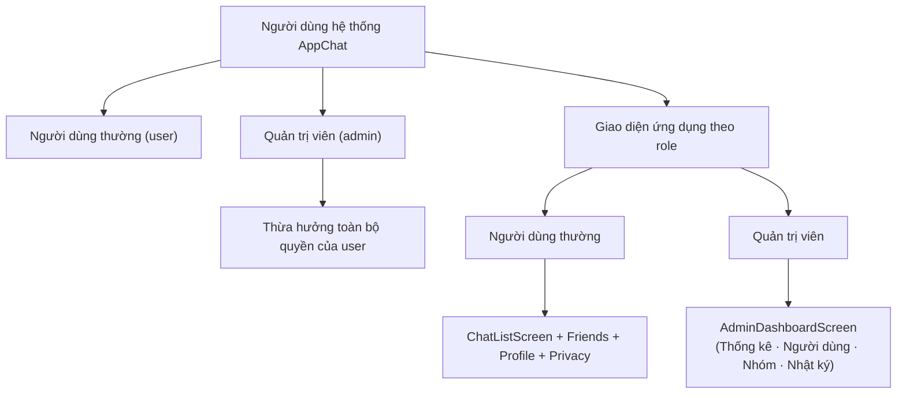
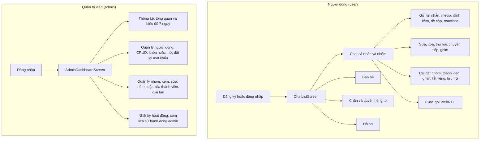
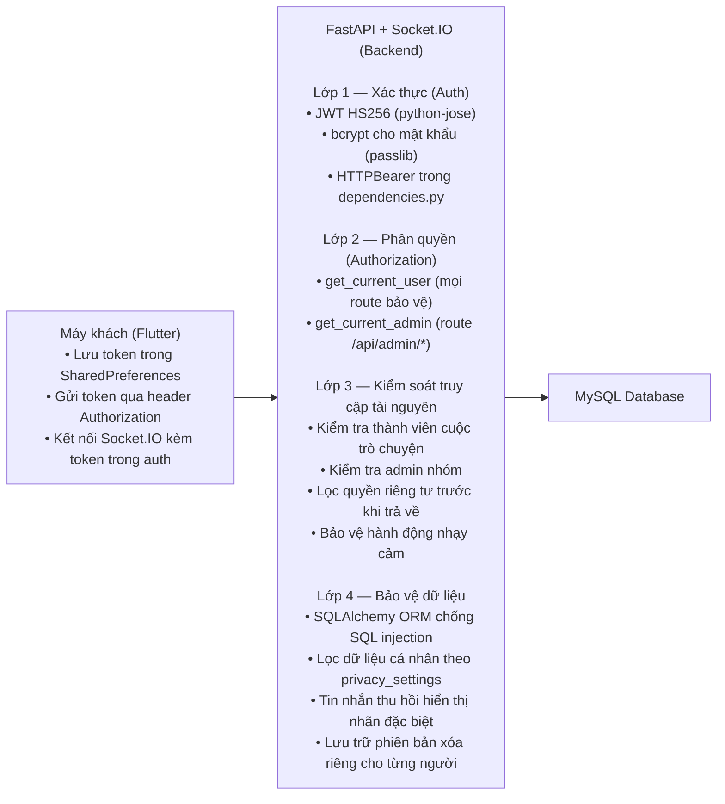

# AppChat — Phân tích hệ thống

Tài liệu phân tích hệ thống ứng dụng chat AppChat (Flutter + FastAPI), tập trung vào nhóm người dùng, chức năng chính, và bảo mật ứng dụng. Mọi nhận định đều căn cứ vào mã nguồn hiện tại của dự án.

---

## 3.1 Nhóm người dùng

### 3.1.1 Tổng quan

AppChat chia người dùng thành hai cấp được lưu trong cột `role` của bảng `users`: cấp thường (`user`) và cấp quản trị (`admin`). Cấp quản trị không phải là một hệ thống riêng biệt mà thừa hưởng toàn bộ quyền của người dùng thường, rồi cộng thêm quyền quản trị hệ thống.

Ở backend, việc phân quyền dựa trên hai dependency chính. Hàm `get_current_user` giải mã JWT từ header `Authorization: Bearer <token>`, trả về thông tin người dùng hiện tại. Hàm `get_current_admin` thực hiện thêm một bước kiểm tra: sau khi giải mã JWT thành công, nó xác nhận `role == "admin"`, nếu không sẽ trả về mã lỗi 403. Tất cả các route cần bảo vệ đều sử dụng `Depends(get_current_user)`, riêng các route quản trị dùng `Depends(get_current_admin)`.

Ở frontend Flutter, sau khi đăng nhập thành công, ứng dụng đọc giá trị `role` từ phản hồi. Nếu là `admin` thì điều hướng tới `AdminDashboardScreen`, ngược lại tới màn hình chat chính.

Người dùng thường có thể tự đăng ký tài khoản qua giao diện đăng ký. Quản trị viên thì không tự đăng ký được mà phải do một quản trị viên khác tạo trong trang quản trị.

Về quản lý nhóm, người dùng thường chỉ quản lý thành viên trong nhóm do mình tạo ra. Quản trị viên có quyền rộng hơn: quản lý mọi nhóm trong toàn hệ thống, bao gồm xem chi tiết, sửa tên hoặc ảnh đại diện, thêm hoặc xóa thành viên, và giải tán nhóm.

Về bảng điều khiển, người dùng thường không truy cập bảng này. Quản trị viên có bảng riêng gồm bốn tab: Thống kê tổng quan kèm biểu đồ 7 ngày, Quản lý người dùng (xem danh sách, tìm kiếm, tạo, sửa, khóa hoặc mở khóa, đặt lại mật khẩu, xóa), Quản lý nhóm toàn hệ thống, và Nhật ký hoạt động để xem lại lịch sử hành động của quản trị viên.

Mọi tài khoản đều có thể bị khóa bởi quản trị viên. Khi bị khóa, đăng nhập sẽ trả về mã 403 kèm thông điệp yêu cầu liên hệ quản trị viên. Quản trị viên có thể bị quản trị viên khác khóa, nhưng không thể tự khóa chính mình và không thể tự xóa tài khoản của mình.

### 3.1.2 Sơ đồ phân cấp nhóm người dùng

### 3.1.3 Tài khoản mẫu

Dữ liệu mẫu được cấu hình trong `backend_python/app/seed_data.py`, bao gồm năm tài khoản: một quản trị viên (`admin@gmail.com` / `Admin123`) và bốn người dùng thường (`thanhtung@gmail.com`, `haiphong@gmail.com`, `linhtran@gmail.com`, `minhnguyen@gmail.com` cùng mật khẩu theo mẫu `ThanhTung`, `HaiPhong`, `LinhTran`, `MinhNguyen`).

### 3.1.4 Các trường dữ liệu người dùng chính

Bảng `users` chứa các trường quyết định nhóm và trạng thái người dùng. Trường `role` xác định người dùng thuộc nhóm nào. Trường `is_locked` ngăn đăng nhập khi bị quản trị viên khóa. Trường `is_online` phản ánh trạng thái hiện diện, được cập nhật thông qua sự kiện Socket.IO mỗi khi kết nối hoặc ngắt kết nối. Trường `last_seen` ghi lại thời điểm cuối cùng người dùng hoạt động, có thể bị ẩn đi theo cài đặt quyền riêng tư. Trường `password_hash` lưu mật khẩu đã băm bằng bcrypt, không bao giờ lưu dạng gốc.

---

## 3.2 Chức năng chính theo nhóm người dùng

Chi tiết đầy đủ từng endpoint REST và mã lỗi được ghi trong tài liệu [AppChat_DacTaAPI.md](./AppChat_DacTaAPI.md). Phần này trình bày tổng quan luồng hoạt động.

### Người dùng thường

Người dùng bắt đầu bằng đăng ký hoặc đăng nhập, sau đó vào màn hình danh sách cuộc trò chuyện. Từ đây có thể chuyển sang các nhóm chức năng song song.

Nhóm chat cá nhân và nhóm cho phép gửi tin nhắn văn bản, file đính kèm (ảnh, video, âm thanh), đề cập người dùng khác bằng `@user`, trả lời một tin nhắn, thả biểu cảm (reactions), sửa hoặc xóa tin nhắn (riêng mình hoặc thu hồi cho mọi người), chuyển tiếp tin nhắn sang cuộc trò chuyện khác, và ghim tối đa ba tin nhắn mỗi cuộc trò chuyện. Về quản lý cuộc trò chuyện: tạo chat cá nhân hoặc nhóm, ghim hoặc bỏ ghim cuộc trò chuyện trong danh sách, tắt hoặc bật thông báo, lưu trữ cuộc trò chuyện, và rời nhóm. Với nhóm chat, admin nhóm có thể thêm hoặc xóa thành viên, đổi tên và ảnh đại diện nhóm, tạo hoặc thu hồi liên kết mời. Người dùng khác có thể tham gia nhóm qua liên kết đó. Cuộc gọi thoại và video được hỗ trợ qua WebRTC với tín hiệu báo hiệu qua Socket.IO.

Nhóm bạn bè cho phép gửi lời mời kết bạn theo email, chấp nhận hoặc từ chối lời mời nhận được, hủy kết bạn, và xem danh sách bạn bè cùng lời mời đang chờ.

Nhóm chặn và quyền riêng tư cho phép chặn một người dùng kèm báo cáo lý do (tự động hủy kết bạn nếu đang là bạn), bỏ chặn, xem danh sách đã chặn, và kiểm tra xem có đang chặn nhau hay không. Cài đặt quyền riêng tư gồm bốn mục: ai được xem lần cuối truy cập, ai được xem ảnh đại diện, có hiển thị đã xem tin nhắn hay không, và thời gian tin nhắn tự biến mất (tắt, 24 giờ, 7 ngày, 90 ngày).

Nhóm hồ sơ cho phép cập nhật tên hiển thị, ảnh đại diện, và đổi mật khẩu (yêu cầu mật khẩu cũ đúng).

### Quản trị viên

Quản trị viên đăng nhập giống người dùng thường nhưng được điều hướng tới bảng điều khiển riêng. Tab Thống kê hiển thị tổng số người dùng, đang online, bị khóa, tổng số nhóm, tổng số tin nhắn, cùng biểu đồ cột tần suất tin nhắn và người dùng mới theo 7 ngày gần nhất. Tab Quản lý người dùng cho phép xem danh sách toàn bộ người dùng (kèm tìm kiếm theo tên hoặc email), xem chi tiết từng người, tạo tài khoản mới (chọn email, mật khẩu, tên hiển thị, vai trò), sửa thông tin và vai trò, khóa hoặc mở khóa tài khoản, đặt lại mật khẩu, và xóa tài khoản (kéo theo dữ liệu liên quan qua cascade). Tab Quản lý nhóm hiển thị danh sách tất cả nhóm trong hệ thống, xem chi tiết kèm danh sách thành viên, sửa tên và ảnh đại diện nhóm, thêm hoặc xóa thành viên bất kỳ, và giải tán nhóm. Tab Nhật ký hoạt động ghi lại tất cả hành động quản trị: ai thực hiện, hành động gì, đối tượng nào, địa chỉ IP, và thời điểm. Quản trị viên có thể xem nhật ký với phân trang.

### Sơ đồ luồng chức năng tổng quan

---

## 3.3 Bảo mật ứng dụng

### 3.3.1 Tổng quan bốn lớp bảo mật

Bảo mật của AppChat được thiết kế theo bốn lớp xếp chồng từ ngoài vào trong. Lớp ngoài cùng là xác thực người dùng, tiếp theo là phân quyền dựa trên vai trò, rồi kiểm soát truy cập tài nguyên ở mức đối tượng, và cuối cùng là bảo vệ dữ liệu ở mức cơ sở dữ liệu.

### 3.3.2 Lớp 1 — Xác thực người dùng

Mật khẩu người dùng được băm bằng thuật toán bcrypt với salt tự sinh, cấu hình mặc định 10 vòng. Việc băm do `CryptContext` trong `auth_service.py` quản lý, đảm bảo không có mật khẩu gốc nào được lưu trong cơ sở dữ liệu.

Sau khi đăng nhập thành công, backend tạo JWT token dạng HS256 chứa `sub` là user id, `exp` là thời điểm hết hạn (mặc định 24 giờ), và `iat` để phát hiện token được phát hành. Secret key lấy từ `settings.jwt_secret_key`, không hard-code.

Mỗi khi người dùng gửi yêu cầu tới route được bảo vệ, backend đọc header `Authorization: Bearer <token>`, giải mã JWT, xác nhận token còn hiệu lực, rồi trả về thông tin người dùng. Nếu token hết hạn hoặc không hợp lệ, trả về 401 kèm header `WWW-Authenticate: Bearer`.

Khi đăng nhập, backend kiểm tra trường `is_locked`. Nếu tài khoản bị khóa, đăng nhập bị từ chối với mã 403. Khi đăng xuất, backend cập nhật `is_online = False` và ghi lại `last_seen`.

### 3.3.3 Lớp 2 — Phân quyền

Hai cấp phân quyền được áp dụng. Cấp thứ nhất là phân quyền admin hệ thống: chỉ tài khoản có `role == "admin"` mới truy cập được các route bắt đầu bằng `/api/admin`. Cấp thứ hai là phân quyền admin nhóm: một số hành động như tạo liên kết mời, thêm hoặc xóa thành viên, đổi tên nhóm chỉ người tạo nhóm (hoặc được chỉ định) mới thực hiện được.

Một số hành động nhạy cảm bị hạn chế thêm. Không ai được tự khóa hoặc tự xóa tài khoản của chính mình. Chỉ người gửi mới được sửa hoặc xóa tin nhắn (xóa phía mình thì ai cũng làm được, nhưng thu hồi cho mọi người chỉ người gửi). Không ai được tự chặn chính mình.

### 3.3.4 Lớp 3 — Kiểm soát truy cập tài nguyên

Trước khi trả về tin nhắn hoặc cho phép gửi tin nhắn, backend kiểm tra bản ghi `ChatParticipant` để xác nhận người dùng thực sự là thành viên của cuộc trò chuyện đó. Nếu không phải thành viên, trả về 403.

Dữ liệu cá nhân như `last_seen` và `avatar_url` được lọc trước khi trả về thông qua hàm `filter_user_dict` trong `privacy_service.py`. Hàm này kiểm tra cài đặt quyền riêng tư của người được xem (ai được xem, chỉ bạn bè, hay không ai) rồi xóa các trường tương ứng.

Khi người dùng A chặn người dùng B, hai bên không thể gửi tin nhắn cho nhau qua các cuộc trò chuyện chung. Quan hệ bạn bè giữa hai người cũng tự động bị hủy.

### 3.3.5 Lớp 4 — Bảo vệ dữ liệu và kiểm soát đầu vào

Toàn bộ truy vấn cơ sở dữ liệu sử dụng SQLAlchemy ORM, các tham số được truyền qua ràng buộc (`bind parameters`) chứ không cộng chuỗi SQL thủ công. Điều này loại bỏ phần lớn nguy cơ SQL injection.

Đầu vào từ người dùng được xác thực qua Pydantic schema trước khi xử lý: email phải đúng định dạng, mật khẩu tối thiểu 6 ký tự, tên hiển thị tối thiểu 1 ký tự.

File tải lên bị giới hạn ở 10 MB và kiểm tra content type. Khi phân loại ảnh, chỉ file có `content_type` bắt đầu bằng `image/` mới được chấp nhận. URL xem trước Open Graph chỉ chấp nhận scheme `http` hoặc `https`.

Tin nhắn đã thu hồi không hiển thị nội dung gốc mà chỉ hiển thị nhãn "Tin nhắn đã thu hồi", ẩn hoàn toàn media và thông tin nhạy cảm. Mỗi người dùng có bản ghi xóa riêng trong bảng `DeletedMessage`: xóa phía mình không ảnh hưởng người khác. Mỗi thành viên cuộc trò chuyện có mốc `messages_cleared_at` riêng: xóa lịch sử chỉ ảnh hưởng bản thân.

Liên kết mời nhóm được tạo bằng `secrets.token_urlsafe(16)` tạo mã ngẫu nhiên 16 byte, khó đoán. Mỗi nhóm chỉ có một liên kết còn hiệu lực; khi tạo mới, liên kết cũ tự động bị vô hiệu hóa.

### 3.3.6 Bảo mật kênh truyền realtime

Kết nối Socket.IO yêu cầu JWT token qua trường `auth`. Backend xác thực token, nếu hợp lệ sẽ set trạng thái `is_online = True`. Mỗi người dùng có một phòng riêng `user_{id}`: chỉ chủ phòng mới nhận được sự kiện nhắm vào phòng đó, phù hợp cho thông báo đề cập, thu hồi tin nhắn, và các sự kiện realtime cá nhân khác. Muốn nhận sự kiện cuộc trò chuyện, người dùng phải chủ động gửi `join_chat` để tham gia phòng `chat_{id}`. Tín hiệu đang nhập (`typing`) chỉ là thông tin tiện ích, không ảnh hưởng dữ liệu. Khi server khởi động lại, toàn bộ `is_online` được reset về `False` để tránh trạng thái kẹt.

### 3.3.7 Bảo mật phía Flutter

Token JWT được lưu trong SharedPreferences trên thiết bị để duy trì phiên đăng nhập. Khi khởi động, ứng dụng tự kiểm tra token: nếu còn hợp lệ thì đăng nhập tự động, nếu hết hạn thì yêu cầu đăng nhập lại.

### 3.3.8 Nhật ký hoạt động quản trị

Bảng `activity_logs` ghi lại mọi hành động quản trị: ai thực hiện (`admin_id`), hành động cụ thể (ví dụ "khóa người dùng", "giải tán nhóm"), loại đối tượng bị tác động (`user`, `group`, `message`), mã đối tượng, mô tả chi tiết, địa chỉ IP, và thời điểm. Quản trị viên xem nhật ký qua tab Nhật ký hoạt động với phân trang. Cơ chế này phục vụ truy vết hành vi và răn đe hành động sai.

### 3.3.9 Lưu ý bảo mật khi triển khai

Khi triển khai thực tế, cần thay giá trị mặc định của `jwt_secret_key` bằng giá trị ngẫu nhiên, đặt trong file `.env` và không commit file này lên kho mã. Mật khẩu cơ sở dữ liệu cũng phải qua biến môi trường, không hard-code. HTTPS bắt buộc để bảo vệ JWT truyền qua mạng. CORS hiện đang mở cho mọi nguồn, cần thu hẹp lại theo miền triển khai thực tế. Bật sao lưu tự động cho MySQL và cân nhắc mã hóa dữ liệu nhạy cảm.

---

## Phụ lục: Ánh xạ module — chức năng chính

Chi tiết đầy đủ từng endpoint REST (phương thức, đường dẫn, request, response, mã lỗi) xem trong [AppChat_DacTaAPI.md](./AppChat_DacTaAPI.md). Phần này chỉ liệt kê ánh xạ tổng quan.

Nhóm auth gồm đăng ký, đăng nhập, đăng xuất, lấy thông tin hiện tại (`auth.py`). Nhóm user gồm hồ sơ cá nhân, đổi mật khẩu, tìm kiếm người dùng, xem thông tin người khác (`user.py`). Nhóm chat gồm toàn bộ thao tác cuộc trò chuyện và tin nhắn (`chat.py`). Nhóm friend gồm kết bạn, danh sách bạn, lời mời (`friend.py`). Nhóm block gồm chặn, bỏ chặn, kiểm tra chặn (`block.py`). Nhóm privacy gồm cài đặt quyền riêng tư (`privacy.py`). Nhóm invite gồm tạo, lấy, thu hồi, tham gia link mời nhóm (`group_invite.py`). Nhóm image gồm phân loại ảnh ONNX (`image.py`). Nhóm admin gồm quản trị người dùng, nhóm, nhật ký (`admin.py`).

Phía Flutter: module auth xử lý đăng nhập, đăng ký, splash, lưu trữ token; module chat xử lý danh sách chat, chi tiết, tạo chat, tham gia nhóm, cài đặt nhóm; module friends xử lý bạn bè; module profile xử lý hồ sơ, quyền riêng tư, danh sách đã chặn; module admin xử lý bảng điều khiển quản trị. Các service cốt lõi gồm `socket_service.dart` cho kết nối realtime, `webrtc_call_service.dart` cho cuộc gọi WebRTC, và `api_service.dart` cho gọi REST API.
