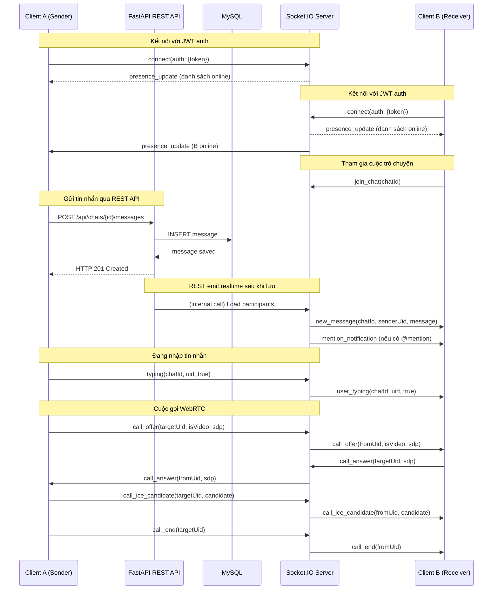

# AppChat — WebSocket (Socket.IO + WebRTC)

Tài liệu mô tả cách AppChat sử dụng Socket.IO cho giao tiếp realtime và WebRTC cho cuộc gọi thoại/video. Giao tiếp realtime là lớp bổ sung trên nền REST API: REST xử lý các thao tác tạo/sửa/xóa có trạng thái bền vững, còn Socket.IO phục vụ các sự kiện cần phản hồi tức thời như tin nhắn đến, đang nhập, và cuộc gọi.

---

## 1. Kiến trúc tổng quan

### 1.1. Phía server

Server dùng `python-socketio` chạy ở chế độ ASGI, được mount vào ứng dụng FastAPI trong `main.py`. Tại `run.py`, server khởi chạy bằng `uvicorn app.main:socket_app` thay vì `uvicorn app.main:app`, đảm bảo cả FastAPI HTTP endpoints lẫn Socket.IO events cùng phục vụ trên một cổng.

```python
# backend_python/app/socket_instance.py
import socketio

sio = socketio.AsyncServer(
    async_mode="asgi",
    cors_allowed_origins="*"
)
```

```python
# backend_python/app/main.py
from app.socket_instance import sio
from fastapi import FastAPI

app = FastAPI()
socket_app = socketio.ASGIApp(sio, app)
```

Tất cả event handlers được đăng ký bằng decorator `@sio.event` trong `main.py`, chia thành hai nhóm: handlers cho kết nối/kết thúc/presence và handlers cho WebRTC signaling.

### 1.2. Phía client

Ứng dụng Flutter dùng thư viện `socket_io_client`. Service `SocketService` là singleton, khởi tạo kết nối khi đăng nhập thành công và ngắt kết nối khi đăng xuất.

```dart
// lib/core/services/socket_service.dart
class SocketService {
  static final SocketService instance = SocketService._();
  SocketService._();

  Socket? _socket;
  String? _currentChatId;

  void connect(String uid) {
    _socket = io.io(
      AppConfig.wsUrl,
      io.OptionBuilder()
          .setTransports(['websocket'])
          .disableAutoConnect()
          .setReconnectionDelay(3000)
          .build(),
    );

    _socket!.onConnect((_) {
      _socket!.emit('user_online', uid);
      if (_currentChatId != null) {
        _socket!.emit('join_chat', _currentChatId);
      }
    });

    _socket!.on('new_message', _handleNewMessage);
    _socket!.on('user_typing', _handleTyping);
    _socket!.on('presence_update', _handlePresenceUpdate);
    _socket!.on('message_deleted', _handleMessageDeleted);
    _socket!.on('message_edited', _handleMessageEdited);
    _socket!.on('reaction_update', _handleReactionUpdate);
    _socket!.on('pin_update', _handlePinUpdate);
    _socket!.on('mention_notification', _handleMentionNotification);
    _socket!.on('history_cleared', _handleHistoryCleared);
    _socket!.on('message_read', _handleMessageRead);
    // WebRTC
    _socket!.on('call_offer', _handleCallOffer);
    _socket!.on('call_answer', _handleCallAnswer);
    _socket!.on('call_ice_candidate', _handleCallIceCandidate);
    _socket!.on('call_end', _handleCallEnd);
    _socket!.on('call_reject', _handleCallReject);

    _socket!.connect();
  }
}
```

Kết nối được khôi phục tự động: sau khi reconnect, client emit `user_online` lại và `join_chat` với `_currentChatId` đã lưu trước đó.

---

## 2. Quản lý kết nối và trạng thái online

### 2.1. Vòng đời kết nối (server)

```python
# backend_python/app/main.py

connected_users: dict[str, int] = {}  # sid -> user_id

@sio.event
async def connect(sid, environ, auth):
    # 1. Xác thực JWT từ auth
    token = auth.get('token') if auth else None
    if token:
        uid = AuthService.decode_token(token)
        if uid:
            await _set_user_online(sid, uid, True)

    # 2. Gửi danh sách online hiện tại cho client mới kết nối
    online_uids = set(connected_users.values())
    for uid in online_uids:
        await sio.emit('presence_update',
                       {'uid': str(uid), 'is_online': True},
                       to=sid)

@sio.event
async def disconnect(sid):
    user_id = connected_users.pop(sid, None)
    if user_id is not None:
        # Tránh kẹt "đang soạn tin" khi mất kết nối đột ngột
        await sio.emit('user_typing',
                       {'uid': str(user_id), 'isTyping': False})

        # Chỉ set offline nếu user không còn sid nào khác (nhiều thiết bị)
        still_connected = any(uid == user_id for uid in connected_users.values())
        if not still_connected:
            await _set_user_online(sid, user_id, False)

async def _set_user_online(sid, user_id, online: bool):
    uid_int = int(user_id)
    if online:
        connected_users[sid] = uid_int
        await sio.enter_room(sid, f"user_{uid_int}")

    # Cập nhật database
    await db.execute(
        update(User).where(User.id == uid_int)
        .values(is_online=online, last_seen=datetime.now() if not online else None)
    )

    # Broadcast tới tất cả client biết user này online/offline
    await sio.emit('presence_update',
                   {'uid': str(uid_int), 'is_online': online})
```

Server lưu `connected_users` trong bộ nhớ để tra ngược từ `sid` ra `user_id`, phục vụ WebRTC khi cần gửi tới đúng thiết bị. Khi server khởi động lại (`lifespan`), toàn bộ `User.is_online` được reset về `False` để tránh trạng thái kẹt.

### 2.2. Cập nhật trạng thái online (client)

```dart
// Client gửi lên khi kết nối thành công
_socket!.emit('user_online', uid);
```

Mọi client nhận sự kiện `presence_update` từ server, cập nhật danh sách bạn bè và giao diện admin theo thời gian thực.

---

## 3. Hai loại phòng (Rooms)

Hệ thống dùng hai loại phòng, mỗi loại phục vụ một mục đích riêng:

| Phòng | Cách tham gia | Mục đích | Ví dụ sự kiện |
|-------|--------------|---------|---------------|
| `user_{uid}` | Server tự động khi user online | Gửi sự kiện cá nhân tới user đó | Tin nhắn mới, mention, thu hồi, cuộc gọi đến |
| `chat_{chat_id}` | Client emit `join_chat` | Gửi sự kiện theo cuộc trò chuyện | Typing, xóa lịch sử |

Sự phân tách này đảm bảo user chỉ nhận thông báo cá nhân khi đang ở màn hình khác, và nhận sự kiện cuộc trò chuyện khi đang ở trong chat.

---

## 4. Tin nhắn realtime

### 4.1. Luồng đi từ REST sang Socket.IO

Tin nhắn được gửi qua REST endpoint `POST /api/chats/{id}/messages`. Sau khi lưu vào database, server load danh sách participants rồi emit tới phòng `user_{uid}` của từng thành viên trừ người gửi:

```python
# backend_python/app/routes/chat.py (khoảng dòng 320-331)
@sio.event
async def send_message(sid, data):
    # ... xử lý REST, lưu DB ...

    # Gửi realtime tới từng participant
    participants_result = await db.execute(
        sa_select(ChatParticipant.user_id)
        .where(ChatParticipant.chat_id == chat_id)
    )
    participant_ids = [uid for (uid,) in participants_result.all()]

    for uid in participant_ids:
        if uid != current_user.id:
            await sio.emit("new_message", {
                "chatId": chat_id,
                "senderUid": str(current_user.id),
                "senderName": current_user.display_name,
                "message": message.to_dict()
            }, room=f"user_{uid}")

            # Gửi thông báo riêng nếu có @mention
            if uid in mention_uids:
                await sio.emit("mention_notification", {
                    "chatId": chat_id,
                    "senderUid": str(current_user.id),
                    "senderName": current_user.display_name,
                    "message": message.to_dict()
                }, room=f"user_{uid}")
```

Khi client nhận `new_message`, message được thêm vào stream `onMessage` để `ChatDetailScreen` hiển thị tức thì mà không cần reload.

### 4.2. Các sự kiện tin nhắn

```dart
// lib/core/services/socket_service.dart — các listener

// Tin nhắn mới
void _handleNewMessage(data) {
  final chatId = data['chatId'];
  final senderUid = data['senderUid'];
  final message = Message.fromJson(data['message']);
  _newMessageController.add(_RealtimeMessage(
    type: _RealtimeEventType.newMessage,
    chatId: chatId,
    senderUid: senderUid,
    message: message,
  ));
}

// Đang nhập tin nhắn
void _handleTyping(data) {
  _typingController.add(_TypingEvent(
    chatId: data['chatId'],
    uid: data['uid'],
    isTyping: data['isTyping'],
  ));
}

// Sửa tin nhắn
void _handleMessageEdited(data) {
  _editController.add(_EditEvent(
    chatId: data['chatId'],
    message: Message.fromJson(data['message']),
  ));
}

// Thu hồi tin nhắn
void _handleMessageDeleted(data) {
  _deleteController.add(_DeleteEvent(
    chatId: data['chatId'],
    messageId: data['messageId'],
    isDeleted: data['isDeleted'] ?? true,
  ));
}

// Ghim/bỏ ghim tin nhắn
void _handlePinUpdate(data) {
  _pinController.add(_PinEvent(
    chatId: data['chatId'],
    messageId: data['messageId'],
    isPinned: data['isPinned'],
  ));
}

// Reaction thay đổi
void _handleReactionUpdate(data) {
  _reactionController.add(_ReactionEvent(
    chatId: data['chatId'],
    message: Message.fromJson(data['message']),
  ));
}

// Xóa lịch sử
void _handleHistoryCleared(data) {
  _historyClearedController.add(data['chatId']);
}

// Đánh dấu đã đọc
void _handleMessageRead(data) {
  _readController.add(_ReadEvent(
    chatId: data['chat_id'],
    messageId: data['message_id'],
    userId: data['user_id'],
  ));
}
```

---

## 5. Sự kiện nhắn @mention

Khi gửi tin nhắn có `@user` hoặc `@all`, server phát thêm `mention_notification` tới phòng `user_{uid}` của từng người được nhắc:

```python
# backend_python/app/routes/chat.py
if uid in mention_uids:
    await sio.emit("mention_notification", {
        "chatId": chat_id,
        "senderUid": str(current_user.id),
        "senderName": current_user.display_name,
        "message": message.to_dict()
    }, room=f"user_{uid}")
```

Phía Flutter, `CallHandler` widget toàn cục lắng nghe `onMentionNotification` và hiển thị thông báo trên màn hình bất kỳ (kể cả khi đang ở trong cuộc trò chuyện khác), giúp user không bỏ lỡ khi bị nhắc tên.

---

## 6. Typing indicator

Client gửi tín hiệu đang nhập:

```dart
// lib/core/services/socket_service.dart
void sendTyping(String chatId, String uid, bool isTyping) {
  _socket?.emit('typing', {
    'chatId': chatId,
    'uid': uid,
    'isTyping': isTyping,
  });
}
```

Server re-emit lại tới phòng `chat_{chatId}` (trừ người gửi):

```python
# backend_python/app/main.py (khoảng dòng 161-177)
@sio.event
async def typing(sid, data):
    chat_id = data.get('chatId')
    uid = data.get('uid')
    is_typing = data.get('isTyping')
    await sio.emit('user_typing', {
        'chatId': chat_id,
        'uid': uid,
        'isTyping': is_typing
    }, room=f"chat_{chat_id}", skip_sid=sid)
```

Khi disconnect hoặc `leave_chat`, server tự động phát `isTyping=False` để tránh kẹt trạng thái "đang soạn tin" của người đã thoát.

---

## 7. Tham gia và rời cuộc trò chuyện

```python
# backend_python/app/main.py

@sio.event
async def join_chat(sid, data):
    chat_id = data.get('chat_id') or data.get('chatId')
    if chat_id:
        await sio.enter_room(sid, f"chat_{chat_id}")

@sio.event
async def leave_chat(sid, data):
    chat_id = data.get('chat_id') or data.get('chatId')
    if chat_id:
        await sio.emit('user_typing', {
            'uid': connected_users.get(sid),
            'isTyping': False
        }, room=f"chat_{chat_id}")
        await sio.leave_room(sid, f"chat_{chat_id}")
```

```dart
// lib/core/services/socket_service.dart
void joinChat(String chatId) {
  _currentChatId = chatId;
  _socket?.emit('join_chat', chatId);
}

void leaveChat(String chatId) {
  _socket?.emit('leave_chat', chatId);
  _currentChatId = null;
}
```

Client gọi `joinChat` khi mở `ChatDetailScreen` và `leaveChat` khi rời khỏi màn hình.

---

## 8. WebRTC cho cuộc gọi thoại và video

### 8.1. Tổng quan luồng báo hiệu (Signaling)

WebRTC cần trao đổi SDP offer/answer và ICE candidates giữa hai peer. AppChat dùng Socket.IO làm kênh báo hiệu, vì Socket.IO đã có kết nối realtime và xác thực JWT. Không cần server TURN/STUN riêng, hệ thống dùng STUN công cộng của Google.

```dart
// lib/core/services/webrtc_call_service.dart — cấu hình peer connection
final config = {
  'iceServers': [
    {'urls': 'stun:stun.l.google.com:19302'},
    {'urls': 'stun:stun1.l.google.com:19302'},
  ],
};

_peerConnection = await createPeerConnection(config, {});

_peerConnection!.onIceCandidate = (candidate) {
  SocketService.instance.sendCallIceCandidate(_targetUid!, candidate.toMap());
};

_peerConnection!.onTrack = (event) {
  _remoteStream = event.streams[0];
  _setState(CallState.connected);
  _startDurationTimer();
};
```

### 8.2. Cuộc gọi đi (Caller)

```dart
// lib/core/services/webrtc_call_service.dart
Future<void> initCall(String targetUid, bool isVideo) async {
  _targetUid = targetUid;
  _isVideo = isVideo;

  // Lấy media local
  if (isVideo) {
    _localStream = await navigator.mediaDevices.getUserMedia({
      'video': {'facingMode': 'user'},
      'audio': true,
    });
  } else {
    _localStream = await navigator.mediaDevices.getUserMedia({'audio': true});
  }

  // Tạo peer connection
  _peerConnection = await createPeerConnection(_iceServers, {});

  // Thêm track local
  _localStream!.getTracks().forEach((track) {
    _peerConnection!.addTrack(track, _localStream!);
  });

  // Tạo offer
  final offer = await _peerConnection!.createOffer();
  await _peerConnection!.setLocalDescription(offer);

  // Gửi offer qua Socket.IO
  SocketService.instance.sendCallOffer(
    targetUid,
    isVideo,
    _callerName!,
    _callerAvatar ?? '',
    offer.sdp!,
  );
}
```

```python
# backend_python/app/main.py (khoảng dòng 200-217)
@sio.event
async def call_offer(sid, data):
    target_uid = data.get('targetUid')
    is_video = data.get('isVideo', False)
    caller_name = data.get('callerName', '')
    caller_avatar = data.get('callerAvatar', '')
    sdp = data.get('sdp')

    await sio.emit('call_offer', {
        'fromUid': connected_users.get(sid),
        'toUid': target_uid,
        'isVideo': is_video,
        'callerName': caller_name,
        'callerAvatar': caller_avatar,
        'sdp': sdp,
    }, room=f"user_{target_uid}")
```

### 8.3. Cuộc gọi đến (Callee)

Widget `CallHandler` toàn cục lắng nghe `onCallOffer` và hiển thị dialog cho phép Accept hoặc Decline từ bất kỳ màn hình nào:

```dart
// lib/core/widgets/call_handler.dart
class CallHandler extends StatefulWidget {
  // Lắng nghe sự kiện call_offer
  _setupCallOfferListener() {
    SocketService.instance.onCallOffer.listen((data) {
      _showIncomingCallDialog(
        data['fromUid'],
        data['isVideo'],
        data['callerName'],
        data['callerAvatar'],
        data['sdp'],
      );
    });
  }

  void _showIncomingCallDialog(...) {
    showDialog(
      context: context,
      barrierDismissible: false,
      builder: (_) => _IncomingCallDialog(
        callerName: callerName,
        isVideo: isVideo,
        onAccept: () {
          Navigator.push(
            context,
            MaterialPageRoute(
              builder: (_) => CallScreen(
                isCaller: false,
                targetUid: fromUid,
                isVideo: isVideo,
                incomingSdp: sdp,
              ),
            ),
          );
        },
        onDecline: () {
          SocketService.instance.sendCallReject(fromUid);
        },
      ),
    );
  }
}
```

### 8.4. Chấp nhận cuộc gọi

```dart
// lib/core/services/webrtc_call_service.dart
Future<void> acceptCall(String callerUid, bool isVideo, String offerSdp) async {
  _targetUid = callerUid;
  _isVideo = isVideo;

  _peerConnection = await createPeerConnection(_iceServers, {});
  _peerConnection!.onIceCandidate = (candidate) {
    SocketService.instance.sendCallIceCandidate(_targetUid!, candidate.toMap());
  };
  _peerConnection!.onTrack = (event) {
    _remoteStream = event.streams[0];
    _setState(CallState.connected);
  };

  // Đặt remote description từ offer của caller
  await _peerConnection!.setRemoteDescription(
    RTCSessionDescription(offerSdp, 'offer'),
  );

  // Tạo answer
  final answer = await _peerConnection!.createAnswer();
  await _peerConnection!.setLocalDescription(answer);

  // Gửi answer
  SocketService.instance.sendCallAnswer(callerUid, answer.sdp!);
}
```

```python
# backend_python/app/main.py (khoảng dòng 220-231)
@sio.event
async def call_answer(sid, data):
    target_uid = data.get('targetUid')
    sdp = data.get('sdp')

    # Gửi tới TẤT CẢ sid của target (hỗ trợ nhiều thiết bị)
    target_sids = [s for s, uid in connected_users.items() if uid == int(target_uid)]
    for t_sid in target_sids:
        await sio.emit('call_answer', {
            'fromUid': connected_users.get(sid),
            'sdp': sdp,
        }, to=t_sid)
```

### 8.5. Trao đổi ICE candidate

```dart
// lib/core/services/webrtc_call_service.dart
void handleRemoteIceCandidate(Map<String, dynamic> candidateMap) async {
  final candidate = RTCIceCandidate(
    candidateMap['candidate'],
    candidateMap['sdpMid'],
    candidateMap['sdpMLineIndex'],
  );
  await _peerConnection!.addCandidate(candidate);
}
```

```python
# backend_python/app/main.py (khoảng dòng 234-245)
@sio.event
async def call_ice_candidate(sid, data):
    target_uid = data.get('targetUid')
    candidate = data.get('candidate')
    target_sids = [s for s, uid in connected_users.items() if uid == int(target_uid)]
    for t_sid in target_sids:
        await sio.emit('call_ice_candidate', {
            'fromUid': connected_users.get(sid),
            'candidate': candidate,
        }, to=t_sid)
```

### 8.6. Kết thúc và từ chối cuộc gọi

| Hành động | Code phía client | Code phía server |
|-----------|-----------------|-----------------|
| Từ chối cuộc gọi | `sendCallReject(targetUid)` | `main.py:261-272` emit `call_reject` |
| Cúp máy | `sendCallEnd(targetUid)` | `main.py:248-259` emit `call_end` |
| ICE thất bại | `onConnectionState == Failed` → tự gọi `endCall` | — |

```python
# backend_python/app/main.py

@sio.event
async def call_end(sid, data):
    target_uid = data.get('targetUid')
    target_sids = [s for s, uid in connected_users.items() if uid == int(target_uid)]
    for t_sid in target_sids:
        await sio.emit('call_end', {'fromUid': connected_users.get(sid)}, to=t_sid)

@sio.event
async def call_reject(sid, data):
    target_uid = data.get('targetUid')
    target_sids = [s for s, uid in connected_users.items() if uid == int(target_uid)]
    for t_sid in target_sids:
        await sio.emit('call_reject', {'fromUid': connected_users.get(sid)}, to=t_sid)
```

### 8.7. Ghi log cuộc gọi

Sau khi cuộc gọi kết thúc, `CallScreen._finishCall` gọi `_sendCallMessage` để đăng một tin nhắn hệ thống vào chat, giúp lưu lại lịch sử cuộc gọi:

```dart
void _sendCallMessage(String chatId, CallType type, Duration? duration) async {
  String content;
  if (type == CallType.connected) {
    final min = duration!.inMinutes.toString().padLeft(2, '0');
    final sec = (duration.inSeconds % 60).toString().padLeft(2, '0');
    content = 'Cuộc gọi · $min:$sec';
  } else if (type == CallType.rejected) {
    content = 'Cuộc gọi bị từ chối';
  } else if (type == CallType.missed) {
    content = 'Cuộc gọi nhỡ';
  } else {
    content = 'Cuộc gọi đã hủy';
  }

  // Gửi qua REST
  await ApiService.createMessage(chatId, content, type: 'call');

  // Inject vào stream ngay để hiển thị tức thì mà không reload
  SocketService.instance.injectMessage(chatId, content, 'call');
}
```

---

## 9. Bảng tổng hợp sự kiện

### 9.1. Sự kiện từ server tới client

| Sự kiện | Payload | Khi nào | Người nhận |
|---------|---------|---------|------------|
| `presence_update` | `{uid, is_online}` | User kết nối, ngắt, hoặc gọi `user_online` | Tất cả client |
| `new_message` | `{chatId, senderUid, senderName, message}` | REST `POST /api/chats/{id}/messages` | Phòng `user_{uid}` của từng participant (trừ người gửi) |
| `mention_notification` | `{chatId, senderUid, senderName, message}` | Kèm `new_message` khi có @mention | Phòng `user_{uid}` của từng user được nhắc |
| `user_typing` | `{chatId, uid, isTyping}` | Client emit `typing` hoặc disconnect | Phòng `chat_{chatId}` (trừ người gửi) |
| `message_edited` | `{chatId, message}` | REST `PUT /api/chats/messages/{id}` | Phòng `user_{uid}` của tất cả participant |
| `message_deleted` | `{chatId, messageId, isDeleted}` | REST `DELETE ...?for_everyone=true` | Phòng `chat_{chatId}` và `user_{uid}` từng participant |
| `pin_update` | `{chatId, messageId, isPinned}` | REST `POST /api/chats/{id}/messages/{id}/pin` | Phòng `user_{uid}` của từng participant (trừ người ghim) |
| `reaction_update` | `{chatId, message}` | REST `POST /api/chats/messages/{id}/reactions` | Phòng `user_{uid}` của từng participant (trừ người react) |
| `history_cleared` | `{chatId}` | REST `DELETE /api/chats/{id}/messages` | Phòng `chat_{chatId}` |
| `message_read` | `{chat_id, message_id, user_id}` | Client emit `message_read` | Phòng `chat_{chatId}` (trừ người đọc) |
| `call_offer` | `{fromUid, toUid, isVideo, callerName, callerAvatar, sdp}` | Client emit `call_offer` | Phòng `user_{targetUid}` |
| `call_answer` | `{fromUid, sdp}` | Client emit `call_answer` | Từng sid của target user |
| `call_ice_candidate` | `{fromUid, candidate}` | Client emit `call_ice_candidate` | Từng sid của target user |
| `call_end` | `{fromUid}` | Client emit `call_end` hoặc disconnect | Từng sid của target user |
| `call_reject` | `{fromUid}` | Client emit `call_reject` | Từng sid của target user |

### 9.2. Sự kiện từ client tới server

| Sự kiện | Payload | Xử lý |
|---------|---------|-------|
| `user_online` | `uid` | Set online, broadcast `presence_update` |
| `join_chat` | `chatId` | Vào phòng `chat_{chatId}` |
| `leave_chat` | `chatId` | Ra phòng, phát `isTyping=False` |
| `typing` | `{chatId, uid, isTyping}` | Re-emit `user_typing` tới phòng chat |
| `message_read` | `{chat_id, message_id}` | Emit `message_read` tới phòng chat |
| `call_offer` | `{targetUid, isVideo, callerName, callerAvatar, sdp}` | Forward tới `user_{targetUid}` |
| `call_answer` | `{targetUid, sdp}` | Forward tới mọi sid của target |
| `call_ice_candidate` | `{targetUid, candidate}` | Forward tới mọi sid của target |
| `call_end` | `{targetUid}` | Forward tới mọi sid của target |
| `call_reject` | `{targetUid}` | Forward tới mọi sid của target |

---

## 10. Sơ đồ luồng realtime



> **Lưu ý về luồng REST ↔ Socket.IO:** Client **không giao tiếp trực tiếp** với MySQL. Toàn bộ tương tác với database diễn ra ở phía server. Cụ thể:
> - Client gửi HTTP POST tới **FastAPI REST API**.
> - REST API nhận request, ghi vào **MySQL**, rồi gọi nội bộ Socket.IO để phát realtime tới các client đang online.
> - MySQL chỉ giao tiếp với server, không bao giờ tiếp nhận request trực tiếp từ client.
> - Sơ đồ trên tách rõ REST (HTTP) và Socket.IO (WebSocket) thành hai lane riêng biệt.
